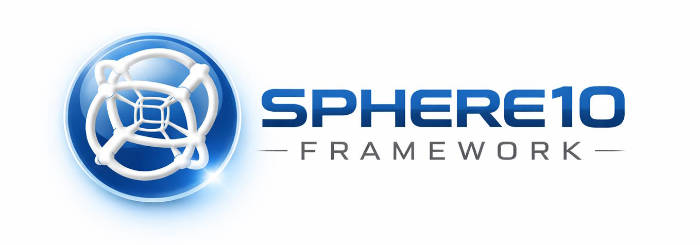

<!-- Copyright (c) 2018-Present Herman Schoenfeld. All rights reserved. Author: Herman Schoenfeld (sphere10.com) -->

<p align="center">
  
</p>


[](https://www.nuget.org/packages/Sphere10.Framework)


# Sphere10 Framework

Copyright © Herman Schoenfeld 2005 - Present

**Build desktop and web applications, embedded storage engines and cryptographic systems with one modular .NET toolkit.**

Sphere10 Framework brings application shells, data access, embedded object storage, collections, binary serialization and cryptography together in one consistent set of C# libraries for .NET 10. Build a complete desktop or web application, compose your own storage engine, or pick the components your existing application needs.

[Explore the features](#what-you-can-build) · [Try the demos](#see-it-in-action) · [Read the docs](docs/README.md) · [Install](#installation)

## What you can build

### Complete desktop and web applications

Compose modular applications from **plugins, application blocks, menus, toolbars, screens and wizards**. The Windows Forms and Blazor adapters share one application model, dependency injection and lifecycle conventions, while each platform renders and hosts its own screens.

- **Windows Forms:** native application shells, detachable tabs, CRUD grids, data-bound editors, validation, splash screens and chart controls.
- **Blazor:** Interactive Server workspaces with tabbed navigation, typed CRUD columns, buffered editing, reference pickers, custom commands, dialogs, wizards and theme switching.
- **Application infrastructure:** startup and shutdown tasks, persisted settings, command-line parsing, logging, screen lifetime policies and unsaved-change handling.

[Application framework](src/Sphere10.Framework.Application/README.md) · [Windows Forms](src/Sphere10.Framework.Windows.Forms/README.md) · [Blazor](src/Sphere10.Framework.Web.AspNetCore.Blazor/README.md) · [Screen Options](docs/usage/screen-options.md)

### Embedded object databases in ordinary streams

**ObjectSpaces persist typed C# objects directly**, with declared identifier, unique and nonunique member indexes, tracked object identity, recyclable storage slots and optional dirty tracking. Choose memory-backed storage or file-backed transactions with explicit commit and rollback.

An ObjectSpace built with `StoreMetaData()`, or an ObjectStream created with `storeMetaData: true`, also stores its construction metadata, including serializer registrations and index settings. A supported store can then rebuild its configuration from the raw stream without a supplied definition. Merkle attachments add cryptographic integrity roots to object stores.

[ObjectSpace guide](src/Sphere10.Framework/ObjectSpaces/README.md) · [Self-describing storage](docs/usage/self-describing-storage.md)

### Collections that fit your data and your storage

Work with **memory, paged and stream-backed lists, dictionaries and sets**, in-memory and stream-mapped B-trees and B+ trees, grouped lookups, recyclable collections, synchronized wrappers and projected views. Extended collection contracts support long-indexed range operations for batch processing.

Clustered streams multiplex independent logical streams into a single backing stream, with dynamic allocation and pluggable attachments. Page sizes, cache budgets, cluster sizes and index layouts give you direct control over memory and I/O policy.

[Core library](src/Sphere10.Framework/README.md) · [Collection selection](docs/guidelines/patterns/collections.md) · [Collections and storage](docs/guidelines/patterns/collections-and-storage.md)

### Binary serialization for complex object graphs

Compose serializers with **explicit member layouts, polymorphic types, shared references, cyclic graphs, size calculation and byte-order control**. Serializer factories and fluent builders connect the same serialization contracts to object stores, collections and typed message protocols.

Use constant-size serializers where predictable offsets matter, `VarInt` and `CVarInt` encodings where size matters, and `EndianBinaryReader` and `EndianBinaryWriter` for stream I/O.

[Serialization guide](docs/guidelines/patterns/serialization.md)

### Cryptographic integrity and specialized security primitives

Build with **pluggable hashing, digital-signature abstractions, verifiable random functions and dynamic Merkle trees**. Merkle-aware lists, dictionaries, sets and object stores bring integrity roots and proofs into the storage layer.

CryptoEx adds ECDSA over the secp256k1, secp384r1, secp521r1 and sect283k1 curves, ECIES encryption, Schnorr and MuSig signatures, and Bitcoin and PascalCoin encodings. The core library implements the AMS signature schemes, including WAMS, and the WOTS and W-OTS# Winternitz one-time signatures, which the project's technical papers describe.

For blockchain applications, `Sphere10.Framework.Consensus` provides reversible chain state, chain and branch management, and proof-of-work target and difficulty algorithms.

[Core cryptography and Merkle trees](src/Sphere10.Framework/README.md) · [CryptoEx](src/Sphere10.Framework.CryptoEx/README.md) · [Blockchain primitives](src/Sphere10.Framework.Consensus/README.md) · [Research papers](#technical-papers)

### Relational data access across database engines

Use a common **data-access contract, scoped connections and transactions, SQL builders and schema metadata** across SQLite, SQL Server, Firebird, MySQL, PostgreSQL and Oracle. NHibernate integration supports ORM-based applications, and the Windows Forms provider packages add connection editors for desktop applications.

Application code uses the same abstractions on every engine, and each provider README documents what its engine supports.

[Data access](src/Sphere10.Framework.Data/README.md) · [NHibernate](src/Sphere10.Framework.Data.NHibernate/README.md)

### Connected services and reusable application infrastructure

Define typed protocols and request/response flows, expose JSON-RPC services, and connect processes through TCP, UDP, anonymous-pipe and WebSocket channels. ASP.NET Core and MVC libraries supply web hosting, middleware, controller and form integrations.

The libraries also provide scheduled jobs, composable caches and loggers, synchronization scopes, reflection and mapping helpers, the `AutoDirty` source generator, and NUnit utilities for application and database testing.

[Communications](src/Sphere10.Framework.Communications/README.md) · [ASP.NET Core](src/Sphere10.Framework.Web.AspNetCore/README.md) · [Job scheduling](docs/guidelines/patterns/scheduling.md)

## Discover the toolkit with `Tools.*`

Type **`Tools.`** in your IDE to explore utilities grouped by domain, such as `Tools.Text`, `Tools.Collection`, `Tools.FileSystem`, `Tools.Reflection`, `Tools.Streams` and `Tools.Crypto`. The database, drawing, web and Windows libraries add their own classes to the same namespace, for example `Tools.Data`, `Tools.Sqlite`, `Tools.Drawing`, `Tools.Html` and `Tools.Windows`.

[Browse the Tools reference](docs/tools-reference.md).

## See it in action

| Explore | What you can try |
|---|---|
| [Windows Forms tester](utils/Sphere10.Framework.Utils.WinFormsTester/README.md) | Native application screens, ObjectSpaces, CRUD controls, charts and component demonstrations |
| [Blazor tester](utils/Sphere10.Framework.Utils.BlazorTester/README.md) | A modular workspace with tabs, editable grids, menus, toolbars, themes, dialogs and wizards |
| [Blazor CRUD quick start](src/Sphere10.Framework.Web.AspNetCore.Blazor/README.md#crud-grid-quick-start) | Build an editable grid with typed columns and validation |
| [Custom editors and reference pickers](src/Sphere10.Framework.Web.AspNetCore.Blazor/README.md#custom-editors-reference-pickers-and-actions) | Connect related records and add application-specific actions |
| [MVC tester](utils/Sphere10.Framework.Utils.MvcTester/README.md) | A minimal ASP.NET Core MVC host for the MVC library |
| [Profiler](utils/Sphere10.Framework.Utils.Profiler/README.md) | BenchmarkDotNet studies of ObjectSpace, B-tree and cache workloads. The [ObjectSpace suite](utils/Sphere10.Framework.Utils.Profiler/ObjectSpaces/README.md) compares index orders, cluster sizes, integrity hashes and memory or file storage. |

Run a tester from the repository root:

```powershell
dotnet run --project utils/Sphere10.Framework.Utils.WinFormsTester -c Release -p:BuildRevision=0
dotnet run --project utils/Sphere10.Framework.Utils.BlazorTester/Sphere10.Framework.Utils.BlazorTester.csproj -c Release -p:BuildRevision=0
```

The WinForms tester needs Windows. The Blazor tester listens on `http://localhost:5187` through its default launch profile. Each tester README describes its screens and other launch options.

## Browse the libraries

The libraries are organized under `src/`, with tests under `tests/` and runnable demonstrations and profiling tools under `utils/`. `recipes/` holds console samples of the protocol API over UDP and anonymous pipes, and only the UDP sample currently has active code. `blackhole/` keeps archived experimental DApp projects for reference. They are not maintained, and neither solution builds or packs them.

Select the packages that fit your application, and read each project guide for its API and platform requirements. A packable project's NuGet package ID is its project name. `Sphere10.Framework.Runtime` and the legacy iOS, Android and macOS projects are not packed. The tables below link to every project's README, grouped by role.

### :gear: Core Framework & Utilities

| Project | Purpose | NuGet |
|---------|---------|-------|
| [**Sphere10.Framework**](src/Sphere10.Framework/README.md) | General-purpose core library with utilities for caching, collections, cryptography, serialization, streaming, and more | [](https://www.nuget.org/packages/Sphere10.Framework) |
| [**Sphere10.Framework.Application**](src/Sphere10.Framework.Application/README.md) | Application lifecycle, dependency injection, shared application/block hierarchy, startup plugins and wizard orchestration | [](https://www.nuget.org/packages/Sphere10.Framework.Application) |
| [**Sphere10.Framework.Communications**](src/Sphere10.Framework.Communications/README.md) | Networking over TCP, UDP, WebSockets and anonymous pipes, with JSON-RPC services | [](https://www.nuget.org/packages/Sphere10.Framework.Communications) |
| [**Sphere10.Framework.Generators**](src/Sphere10.Framework.Generators/README.md) | C# source generators delivered as a compiler analyzer, currently the `AutoDirty` property generator | |
| [**Sphere10.Framework.Runtime**](src/Sphere10.Framework.Runtime/) | Internal C# code builder and math-expression compiler, not packed | |
| [**Sphere10.HashLib4CSharp**](src/Sphere10.HashLib4CSharp/README.md) | Hashing library with support for MD5, SHA, BLAKE2, CRC, checksums, and more | [](https://www.nuget.org/packages/Sphere10.HashLib4CSharp) |

### :lock: Cryptography & Security

| Project | Purpose | NuGet |
|---------|---------|-------|
| [**Sphere10.Framework.CryptoEx**](src/Sphere10.Framework.CryptoEx/README.md) | Elliptic-curve signing/encryption, Schnorr, MuSig and cryptographic integrations | [](https://www.nuget.org/packages/Sphere10.Framework.CryptoEx) |
| [**Sphere10.Framework.Consensus**](src/Sphere10.Framework.Consensus/README.md) | Reversible blockchain state, chain/branch management and proof-of-work target/difficulty primitives | [](https://www.nuget.org/packages/Sphere10.Framework.Consensus) |

### :floppy_disk: Data Access & Persistence

| Project | Purpose | NuGet |
|---------|---------|-------|
| [**Sphere10.Framework.Data**](src/Sphere10.Framework.Data/README.md) | Data access abstraction layer with ADO.NET enhancements, SQL query building, CSV support | [](https://www.nuget.org/packages/Sphere10.Framework.Data) |
| [**Sphere10.Framework.Data.Sqlite**](src/Sphere10.Framework.Data.Sqlite/README.md) | SQLite implementation for embedded databases | [](https://www.nuget.org/packages/Sphere10.Framework.Data.Sqlite) |
| [**Sphere10.Framework.Data.Firebird**](src/Sphere10.Framework.Data.Firebird/README.md) | Firebird database implementation | [](https://www.nuget.org/packages/Sphere10.Framework.Data.Firebird) |
| [**Sphere10.Framework.Data.MSSQL**](src/Sphere10.Framework.Data.MSSQL/README.md) | Microsoft SQL Server implementation | [](https://www.nuget.org/packages/Sphere10.Framework.Data.MSSQL) |
| [**Sphere10.Framework.Data.NHibernate**](src/Sphere10.Framework.Data.NHibernate/README.md) | NHibernate ORM integration | [](https://www.nuget.org/packages/Sphere10.Framework.Data.NHibernate) |
| [**Sphere10.Framework.Data.MySQL**](src/Sphere10.Framework.Data.MySQL/README.md) | MySQL data-access provider | |
| [**Sphere10.Framework.Data.PostgreSQL**](src/Sphere10.Framework.Data.PostgreSQL/README.md) | PostgreSQL data-access provider | |
| [**Sphere10.Framework.Data.Oracle**](src/Sphere10.Framework.Data.Oracle/README.md) | Oracle data-access provider | |

### :desktop_computer: Desktop & Windows

| Project | Purpose | NuGet |
|---------|---------|-------|
| [**Sphere10.Framework.Windows**](src/Sphere10.Framework.Windows/README.md) | Windows platform integration: registry, services, event logging | [](https://www.nuget.org/packages/Sphere10.Framework.Windows) |
| [**Sphere10.Framework.Windows.Forms**](src/Sphere10.Framework.Windows.Forms/README.md) | Windows Forms UI framework and components | [](https://www.nuget.org/packages/Sphere10.Framework.Windows.Forms) |
| [**Sphere10.Framework.Windows.Forms.DataVisualization**](src/Sphere10.Framework.Windows.Forms.DataVisualization/README.md) | Microsoft charting controls adapted to modern .NET, retaining upstream licenses | |
| [**Sphere10.Framework.Windows.Forms.Sqlite**](src/Sphere10.Framework.Windows.Forms.Sqlite/README.md) | SQLite connection editors for Windows Forms | [](https://www.nuget.org/packages/Sphere10.Framework.Windows.Forms.Sqlite) |
| [**Sphere10.Framework.Windows.Forms.Firebird**](src/Sphere10.Framework.Windows.Forms.Firebird/README.md) | Firebird connection editors for Windows Forms | [](https://www.nuget.org/packages/Sphere10.Framework.Windows.Forms.Firebird) |
| [**Sphere10.Framework.Windows.Forms.MSSQL**](src/Sphere10.Framework.Windows.Forms.MSSQL/README.md) | SQL Server connection editors for Windows Forms | [](https://www.nuget.org/packages/Sphere10.Framework.Windows.Forms.MSSQL) |
| [**Sphere10.Framework.Windows.Forms.MySQL**](src/Sphere10.Framework.Windows.Forms.MySQL/README.md) | MySQL connection editors for Windows Forms | |
| [**Sphere10.Framework.Windows.Forms.PostgreSQL**](src/Sphere10.Framework.Windows.Forms.PostgreSQL/README.md) | PostgreSQL connection editors for Windows Forms | |
| [**Sphere10.Framework.Windows.Forms.Oracle**](src/Sphere10.Framework.Windows.Forms.Oracle/README.md) | Oracle connection editors for Windows Forms | |
| [**Sphere10.Framework.Windows.LevelDB**](src/Sphere10.Framework.Windows.LevelDB/README.md) | LevelDB key-value storage integration | [](https://www.nuget.org/packages/Sphere10.Framework.Windows.LevelDB) |

### :globe_with_meridians: Web & Cross-Platform

| Project | Purpose | NuGet |
|---------|---------|-------|
| [**Sphere10.Framework.Web**](src/Sphere10.Framework.Web/README.md) | HTML, sitemap, and presentation models independent of ASP.NET Core | |
| [**Sphere10.Framework.Web.AspNetCore**](src/Sphere10.Framework.Web.AspNetCore/README.md) | Shared ASP.NET Core HTTP, middleware, logging, and lifecycle integration | [](https://www.nuget.org/packages/Sphere10.Framework.Web.AspNetCore) |
| [**Sphere10.Framework.Web.AspNetCore.MVC**](src/Sphere10.Framework.Web.AspNetCore.MVC/README.md) | MVC controllers, forms, filters, routing, and action results | |
| [**Sphere10.Framework.Web.AspNetCore.Blazor**](src/Sphere10.Framework.Web.AspNetCore.Blazor/README.md) | Tabbed Blazor applications, extensible identity controls, and CRUD grids with typed columns, validation, reference editors, dialogs and wizards | |
| [**Sphere10.Framework.Drawing**](src/Sphere10.Framework.Drawing/README.md) | Color and geometry helpers, plus Windows image processing and GDI+ rendering | [](https://www.nuget.org/packages/Sphere10.Framework.Drawing) |
| [**Sphere10.Framework.NUnit**](src/Sphere10.Framework.NUnit/README.md) | NUnit testing utilities and framework test support | |
| [**Sphere10.Framework.NUnit.DB**](src/Sphere10.Framework.NUnit.DB/README.md) | Database-specific NUnit testing utilities | |
| [**Sphere10.Framework.iOS**](src/Sphere10.Framework.iOS/README.md) | Legacy Xamarin.iOS integration, outside the active .NET 10 solutions | |
| [**Sphere10.Framework.Android**](src/Sphere10.Framework.Android/README.md) | Legacy Xamarin.Android integration, outside the active .NET 10 solutions | |
| [**Sphere10.Framework.macOS**](src/Sphere10.Framework.macOS/README.md) | Legacy macOS integration source, outside the active .NET 10 solutions | |

### :test_tube: Test Projects

The [Build workflow](.github/workflows/main.yml) compiles the cross-platform solution and runs the core, Application, CryptoEx, Data, Communications, ASP.NET Core and Blazor test assemblies. A separate job runs the Blazor wizard browser tests through [test-blazor-browser.ps1](scripts/test-blazor-browser.ps1). Run the remaining test projects locally. The Windows, WinForms, LevelDB, HashLib4CSharp and Consensus tests are only in the Windows solution. See the [CI test guide](.github/ci.md) for adding tests, reading failures and reproducing a CI run locally.

| Test Project | Purpose |
|--------------|---------|
| [**Sphere10.HashLib4CSharp.Tests**](tests/Sphere10.HashLib4CSharp.Tests) | Tests for hashing algorithms |
| [**Sphere10.Framework.Communications.Tests**](tests/Sphere10.Framework.Communications.Tests) | Channel disposal, pipe, TCP endpoint, UDP server and RPC dispatch tests. The networked JSON-RPC fixtures are commented out |
| [**Sphere10.Framework.Consensus.Tests**](tests/Sphere10.Framework.Consensus.Tests) | Blockchain state, finalization, block-graph and consensus primitive tests |
| [**Sphere10.Framework.CryptoEx.Tests**](tests/Sphere10.Framework.CryptoEx.Tests) | Cryptography implementation tests |
| [**Sphere10.Framework.Data.Tests**](tests/Sphere10.Framework.Data.Tests) | Database access layer tests |
| [**Sphere10.Framework.Tests**](tests/Sphere10.Framework.Tests) | Core framework tests |
| [**Sphere10.Framework.Application.Tests**](tests/Sphere10.Framework.Application.Tests/README.md) | Shared application model, plugin, block, menu, screen-host and lifecycle tests without UI dependencies |
| [**Sphere10.Framework.Web.AspNetCore.Tests**](tests/Sphere10.Framework.Web.AspNetCore.Tests) | Shared web and MVC integration regressions |
| [**Sphere10.Framework.Web.AspNetCore.Blazor.Tests**](tests/Sphere10.Framework.Web.AspNetCore.Blazor.Tests/README.md) | CRUD grid, table, wizard, plugin, ApplicationBlock and lifecycle regression tests |
| [**Sphere10.Framework.Windows.Forms.Tests**](tests/Sphere10.Framework.Windows.Forms.Tests/README.md) | WinForms application framework, screen hosts, grids, charts, controls and wizards on a Windows desktop |
| [**Sphere10.Framework.Windows.LevelDB.Tests**](tests/Sphere10.Framework.Windows.LevelDB.Tests) | LevelDB integration tests |
| [**Sphere10.Framework.Windows.Tests**](tests/Sphere10.Framework.Windows.Tests) | Windows platform tests |
| [**Sphere10.Framework.Utils.Profiler.Tests**](tests/Sphere10.Framework.Utils.Profiler.Tests/README.md) | Profiler command, ObjectSpace, B-tree, cache and parameter-study tests |
| [**Sphere10.Framework.NET.Tests**](tests/Sphere10.Framework.NET.Tests) | Math-expression scanner and parser tests for `Sphere10.Framework.Runtime`, outside both solutions |

## Documentation and learning

### Getting started

- [**Documentation Home**](docs/README.md) — Documentation index
- [**Getting Started Guide**](docs/start-here.md) — Orientation for new developers
- [**Tools Reference**](docs/tools-reference.md) — Catalog of the `Tools.*` namespace
- [**Real-World Examples**](docs/real-world-usage-examples.md) — Usage patterns drawn from the test suites

### Architecture

- [Framework Architecture](docs/architecture/sphere10-framework.md) — Design philosophy, layers, subsystems
- [Framework Domains](docs/architecture/domains.md) — Domain catalog by architectural tier

### Engineering guides

- [3-Tier Architecture](docs/guidelines/3-tier-architecture.md) — Architectural patterns
- [Code Styling](docs/guidelines/code-styling.md) — Coding standards and conventions
- [Patterns and Practices](docs/guidelines/patterns-and-practices.md) — Task index for the focused pattern guides
- [Framework To-do](src/TODO.md) — Running engineering backlog across all Framework subsystems

### Technical papers

- [Dynamic Merkle Trees](https://sphere10.com/tech/dynamic-merkle-trees)
- [Abstract Merkle Signatures (AMS)](https://sphere10.com/tech/ams)
- [Winternitz Abstracted Merkle Signatures (WAMS)](https://sphere10.com/tech/wams)
- [Faster and Smaller Winternitz Signatures](https://sphere10.com/tech/wots-sharp)

## Contributing

Contributions are welcome.

To submit a change:

1. Fork the repository
2. Create a feature branch (`git checkout -b feature/my-feature`)
3. Commit your changes
4. Push to your branch
5. Open a Pull Request

Please follow the [Code Styling Guidelines](docs/guidelines/code-styling.md), and run the tests that cover your change before you open the pull request.

## License

Sphere10 Framework is distributed under the **MIT License**. See [LICENSE](LICENSE) for the terms.

Some projects keep third-party code under its original license, such as the [command-line parser](src/Sphere10.Framework.Application/CommandLine/License.md) and [Sphere10.Framework.Windows.Forms.DataVisualization](src/Sphere10.Framework.Windows.Forms.DataVisualization/README.md).

## Installation

### Prerequisites

- **.NET 10 SDK**
- An IDE that supports the **.NET 10 SDK**, such as Visual Studio or JetBrains Rider
- **Windows** for the `Sphere10.Framework.Windows*` projects, the Windows solution and the WinForms tester
- Optionally the **.NET 11 SDK**. When the building SDK is version 11 or later, the projects that use the `FrameworkTargetFrameworks` or `FrameworkWindowsTargetFrameworks` list from `Directory.Build.props` also target `net11.0` or `net11.0-windows`. `Directory.Build.targets` compiles those targets with runtime async (`runtime-async=on` in `Features`). With only the .NET 10 SDK, these projects build `net10.0` and `net10.0-windows`.

### NuGet packages

Sphere10 Framework is available as NuGet packages. Install the packages you need:

```bash
# Core framework (required)
dotnet add package Sphere10.Framework

# Additional packages as needed
dotnet add package Sphere10.Framework.Application
dotnet add package Sphere10.Framework.Data
dotnet add package Sphere10.Framework.Data.Sqlite
dotnet add package Sphere10.Framework.CryptoEx
dotnet add package Sphere10.Framework.Communications
```

Each package ID matches a project in the [library catalog](#browse-the-libraries). `Sphere10.Framework.Generators` ships only a compiler analyzer, so reference it with `PrivateAssets="all"`.

To switch an application between Framework project references and packages, follow [Interchangeable source and NuGet references](docs/guidelines/patterns/new-projects.md#interchangeable-source-and-nuget-references). For unreleased changes, publish a prerelease package set to a folder feed with the [private feed](#private-feed) script.

### Build from source

Run these commands from the repository root:

```powershell
dotnet build "src/Sphere10.Framework (CrossPlatform).sln" -c Release -p:BuildRevision=0
dotnet build "src/Sphere10.Framework (Win).sln" -c Release -p:BuildRevision=0
dotnet test tests/Sphere10.Framework.Tests/Sphere10.Framework.Tests.csproj -c Release -p:BuildRevision=0
```

| Solution | Contents |
|---|---|
| `src/Sphere10.Framework (CrossPlatform).sln` | The cross-platform libraries, most of their test projects, the Blazor and MVC testers, the profiler and the protocol recipes |
| `src/Sphere10.Framework (Win).sln` | Every active library, including the Windows, WinForms and DataVisualization projects, with their test projects, the WinForms, Blazor and MVC testers, the profiler and the protocol recipes |

`-p:BuildRevision=0` stamps the file version `3.1.3.0` and leaves the local build counter unchanged. Test projects with a README list their filters and environment needs, such as a Windows desktop session or a browser. In Visual Studio, both solutions list the documentation under **Developer Documentation**, and the root README and packaging scripts under **Misc**.

## Building and publishing packages

Build the full package set on Windows with the .NET 10 SDK.

### Versions

`VersionPrefix` in [Directory.Build.props](Directory.Build.props) holds the numeric release version, and the package and assembly versions derive from it. Across the builds of one release, the NuGet version stays `3.1.3` and the assembly version stays `3.1.3.0`. Only the file version carries a build number, `BuildRevision`, as its fourth component.

| Build | `BuildRevision` | File version |
|---|---|---|
| GitHub Actions | The workflow run number | `3.1.3.114`, for example |
| Local build without `BuildRevision` | The next number from `LOCAL-BUILD-NUMBER` at the repository root (gitignored), shared by the projects of one build session | `3.1.3.N` |
| Local build with `-p:BuildRevision=1` | The supplied number | `3.1.3.1` |

For a prerelease package, pass `-p:Version=3.1.3-preview.1` and keep `VersionPrefix` numeric. Use a new package version for each release, because published versions cannot be overwritten.

### Validate, pack and publish

Run the release scripts from the repository root:

```powershell
./scripts/validate-packages.ps1
./scripts/pack.ps1
./scripts/publish.ps1 -IncludeSymbols -WhatIf
./scripts/publish.ps1 -IncludeSymbols
```

1. [validate-packages.ps1](scripts/validate-packages.ps1) packs every packable library under a unique `0.0.0-validation.*` version and builds isolated consumer projects against those packages alone. It publishes nothing. [NuGet consumer validation](scripts/package-consumers/README.md) describes its checks.
2. [pack.ps1](scripts/pack.ps1) cleans the Windows solution and packs it in Release configuration into a staging folder under `publish/.staging`. After it confirms that every package has matching symbols, it replaces the Framework packages in `nuget-packages`. A failed build leaves the previous packages in place, and other files in the folder are preserved. Packing does not run tests, and `-OutputDirectory` selects another destination.
3. [publish.ps1](scripts/publish.ps1) with `-WhatIf` validates the batch and lists the packages without asking for credentials or pushing anything. Without `-WhatIf`, it pushes the packages to nuget.org.

`publish.ps1` validates the whole batch before it pushes the first package. Each file name must match its package ID and version, a second version of the same package is rejected, and with `-IncludeSymbols` every package needs a matching `.snupkg`. The script selects only `Sphere10.Framework*` and `Sphere10.HashLib4CSharp` packages and ignores other files in the folder. Symbols are pushed only with `-IncludeSymbols`.

The API key comes from `-ApiKey`, then the `NUGET_API_KEY` environment variable, then a hidden prompt. Publishing asks for PowerShell confirmation, so an automated run that supplies the key passes `-Confirm:$false`. `-Source`, `-SymbolSource` and `-PackagesDirectory` override the default feeds and package folder. The packing and publishing scripts support Windows PowerShell 5.1 and PowerShell 7, and their default paths resolve from the Framework repository root.

### Private feed

[publish-private.ps1](scripts/publish-private.ps1) is the counterpart of `publish.ps1` for a local folder feed that NuGet restores from, instead of nuget.org. It packs every packable library in the Windows solution under one prerelease version and adds the packages to that folder. It needs no API key and publishes nothing online.

```powershell
./scripts/publish-private.ps1 -WhatIf
./scripts/publish-private.ps1
./scripts/publish-private.ps1 -Feed C:/Packages/sphere10 -Label preview
```

- **Version.** The default is `<VersionPrefix>-private.<yyyyMMdd>.<n>`, for example `3.1.3-private.20261108.1`, where `<n>` is one more than the highest number that the feed already holds for that label and day. `-Label` replaces `private`, and `-Version` sets an exact version. An existing version is never replaced.
- **Feed.** The default is the `SPHERE10_PRIVATE_FEED` environment variable, then a `nuget-private` folder beside the repository. `-Feed` selects any folder. Packages are written in NuGet's hierarchical folder layout (`<id>/<version>/<id>.<version>.nupkg` in lower case, with its `.sha512`, `.nuspec` and `.snupkg` files), which restore reads directly. The script refuses a folder that has packages at its root, because NuGet would read that folder as a flat feed.
- **Safety.** Nothing is added unless every package builds, every `Sphere10.*` dependency resolves to the new set or to the feed, and the Git checkout did not change while packing. By default, the builds use their own artifacts folder under `publish/.staging`, so the checkout's `bin` and `obj` folders stay untouched, and that staging is removed after a successful publish.
- **Preview and staging.** `-WhatIf` shows the version and package list without packing. `-PackOnly` leaves the packages in `-OutputDirectory`, which defaults to `publish/.staging/private-<version>`, for a caller that adds its own packages built against them before publishing the set. The script returns an object with the `Version`, `OutputDirectory` and `Packages` paths.

A consumer adds the folder to its `NuGet.Config` and references an exact version, such as `Version="[3.1.3-private.20261108.1]"`.
