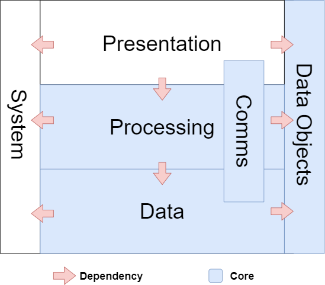
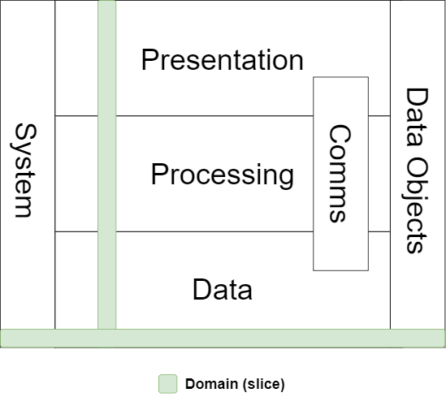
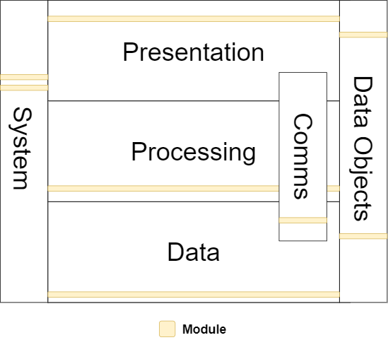
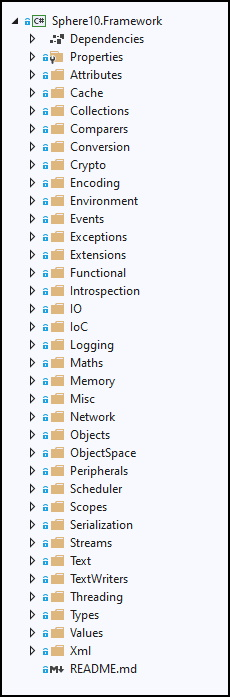
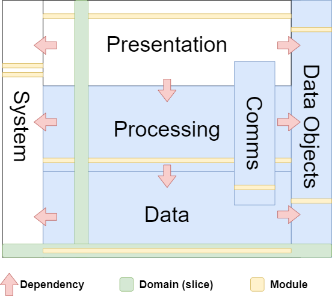

# 3-tier Architecture

A 3-tier architecture separates presentation, processing and data responsibilities. Use this model to reason about an application's boundaries; it does not require exactly three projects or a one-to-one mapping between tiers and Framework assemblies.

1. **Presentation**: responsible for user interfaces and platform presentation. Views, screens and UI adapters invoke application operations and present results. An executable can also be a composition root or service host; running in the background does not by itself make its code presentation logic.

2. **Processing**: responsible for application operations, domain rules and transformations. It coordinates the persistence and communications contracts those operations need. General-purpose algorithms can support this tier without becoming the application's business logic; the core Framework library supplies foundations used across tiers.

3. **Data**: responsible for all things data-persistence. Includes database drivers, blockchain databases, relational databases, file-based storage formats.


### Ancillary-tiers

4. **Communications**: responsible for all the communication modules in the application. This tier is 1-part presentation, 1-part processing and 1-part data depending on the context. Modules include TCP/IP libraries, P2P protocol implementations, JSON API clients and services, Web Sockets libraries for the application. 

5. **Data Objects**: a collection of modules that define data objects used throughout the 3 primary tiers. These include light-weight data objects, POCO, file format definitions, database entities, blockchain objects, data-transfer objects (DTOs).

6. **System**: general-purpose foundations reused by other tiers. Assess dependencies through the actual project and API; this designation does not promise that every utility assembly has no dependencies.




## Domain

A domain is a grouping of classes that are all logically related in the abstraction they model. The classes in a domain define the object model for that particular abstraction. A domain may span across multiple tiers of the 3-tier architecture and can be depicted as a vertical slice through it (see diagram below). Not all domains span the all tiers, most are contained within one or a few. 

*Example: In the solution space for modelling a "School", domains include Teachers, Students, Admin, Classes, Subjects, Exams.* 





## Module

A module groups related responsibilities into a library, executable or resource collection. A tier can contain several modules, and a reusable module can supply shared contracts or foundations used across tiers. The project boundary and dependencies determine what it can use; a folder name alone does not establish an architectural boundary. A code module is a reusable library, an executable module supplies an entry point such as a console app or service host, and a resource module supplies assets such as images, HTML, scripts or localization data.



### Code Module

A module may support several related domains. Organize its implementation into meaningful folders without assuming that each folder requires a separate project or namespace.

**Example: module that supports multiple domains **




#### Naming Convention

The naming convention for modules is: `Company.Product.Tier.Domain`.

**Examples**

```
McDonalds.PointOfSale.Presentation.PointOfSale
McDonalds.PointOfSale.Processing.Ordering
McDonalds.PointOfSale.Data.SAP;
```

Preserve established names when their meaning is clear. Framework's general-purpose library is named `Sphere10.Framework`, with specialized modules such as `Sphere10.Framework.Application`, `Sphere10.Framework.Data` and `Sphere10.Framework.Communications`. The repository does not require a `.Core` suffix or every tier token in every existing module name. Follow [Code Styling](code-styling.md#namespaces) for namespace layout and [Type Hierarchies](patterns/type-hierarchies.md) for contract, base, implementation and decorator naming.

```
Sphere10.Framework.Communications     ; Includes networking and protocols
```


## Framework

A framework supplies reusable modules and contracts used to build applications. Tiers describe responsibilities within those applications; the supplied modules can serve several tiers and domains. Reuse the existing layers according to [Framework Reuse and Adoption](patterns/framework-reuse.md) rather than creating parallel infrastructure to match a diagram mechanically.



## Framework project boundaries

These current project references show how the repository applies the model:

| Existing module | Observed boundary |
|---|---|
| [Sphere10.Framework](../../src/Sphere10.Framework/Sphere10.Framework.csproj) | General-purpose algorithms, collections and storage foundations; its project currently has no project references. |
| [Sphere10.Framework.Data](../../src/Sphere10.Framework.Data/Sphere10.Framework.Data.csproj) | Data-access contracts and utilities built on core. |
| [Sphere10.Framework.Data.NHibernate](../../src/Sphere10.Framework.Data.NHibernate/Sphere10.Framework.Data.NHibernate.csproj) | ORM integration referencing Data, the MSSQL provider and core. |
| [Sphere10.Framework.Application](../../src/Sphere10.Framework.Application/Sphere10.Framework.Application.csproj) | UI-independent lifecycle, settings and shared UI contracts; references Data and core. |
| [Sphere10.Framework.Windows.Forms](../../src/Sphere10.Framework.Windows.Forms/Sphere10.Framework.Windows.Forms.csproj) | Native UI adapter referencing Application, Data, Drawing, Windows and core. |
| [Sphere10.Framework.Web.AspNetCore.Blazor](../../src/Sphere10.Framework.Web.AspNetCore.Blazor/Sphere10.Framework.Web.AspNetCore.Blazor.csproj) | Browser UI adapter referencing Web.AspNetCore and the ASP.NET Core shared framework. |

The [application dependency fixture](../../tests/Sphere10.Framework.Application.Tests/Architecture/ApplicationDependencyTests.cs) checks that Application's framework dependency closure does not reference platform UI assemblies. Shared screen/menu contracts belong in that independent layer; their native and browser implementations belong in the platform adapters. See [Application Ownership](patterns/application-ownership.md) and the [framework architecture guide](../architecture/sphere10-framework.md) for the runtime model and module overview.


