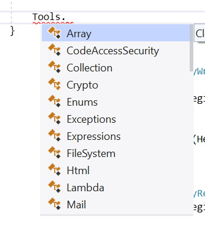

# Code Styling Guidelines

Sphere 10 Software employs its own code-styling approach, which all contributions must follow. This document provides the formatting and naming rules. The repository's `.editorconfig` assists Visual Studio and ReSharper, but does not enforce every rule or replace this guide. Preserve the written conventions when legacy code or editor defaults differ.

[Visual Studio & Resharper Editor Config](../../src/.editorconfig)

**NOTE:** This document is still evolving and contributors should refresh themselves periodically.

**NOTE:** If a styling element / aspect is not addressed by this document (or editor config) then the contributor has artistic license by default.

### Language and source conventions

- `LangVersion` is `latest`.
- `Nullable` is `annotations`: existing nullable annotations remain supported,
  while nullable-reference analysis warnings are disabled. Declare reference types
  without `?` annotations and do not use postfix null-forgiving `!` operators.
  Configure nullable-reference warning suppression in the project. Nullable value
  types remain appropriate when required by the API.
- `ImplicitUsings` is disabled; add explicit `using` directives.

These shared settings come from [Directory.Build.props](../../Directory.Build.props); projects can declare their target and required platform settings separately. The [core project](../../src/Sphere10.Framework/Sphere10.Framework.csproj) and [WinForms project](../../src/Sphere10.Framework.Windows.Forms/Sphere10.Framework.Windows.Forms.csproj) illustrate the ordinary and Windows targets. The examples below illustrate formatting; member fragments assume their enclosing types and collaborators.

All new source files must include the copyright header:

```csharp
// Copyright (c) Herman Schoenfeld 2018 - Present. All rights reserved. (https://sphere10.com)
// Author: Herman Schoenfeld
//
// Distributed under the MIT software license, see the accompanying file
// LICENSE or visit https://opensource.org/license/mit.
//
// This notice must not be removed when duplicating this file or its contents, in whole or in part.
```

### Using directives

Order namespace imports from general to specific. Put `System` namespaces first, followed by library and project namespaces; more complex namespaces such as `Sphere10.Framework.ObjectSpaces` belong at the end. Within a namespace family, put the parent namespace before its children. Apply this rule to source, tests and code examples.

```csharp
using System;
using System.Collections;
using System.Collections.Generic;
using System.Collections.ObjectModel;
using System.Linq;
using Sphere10.Framework.ObjectSpaces;
```

### Braces at end-of-line

Braces should begin at end of line and finish at beginning of line (with corresponding tab offsets)

```csharp
public class SomeClass {
	public void SomeMethod(bool condition, bool nestedCondition) {
		if (condition) {
			if (nestedCondition) {
				FirstOperation();
				SecondOperation();
			} else {
				ThirdOperation();
				FourthOperation();
			}
		}
	}
}
```


### Generic constraints

Place each generic `where` constraint on its own line, aligned one tab beneath the type or method declaration. Keep the opening brace at the end of the final constraint line. Use this structure even when the constraints would fit within the ordinary line-length limit; apply it to source, tests, demos and documentation examples.

```csharp
using Sphere10.Framework.Application.UI;

public abstract class ScreenFactoryBase<TBlock, TScreen>
	where TBlock : class, IApplicationBlock
	where TScreen : class, IApplicationScreen {
	protected TScreen CreateScreen<TConcrete>()
		where TConcrete : TScreen, new() {
		return new TConcrete();
	}
}
```

For declarations without a body, such as interface methods, the terminating semicolon remains at the end of the final constraint line.

### Type source files

Each top-level class or record belongs in its own source file named for the
declared type. This includes internal, abstract, static and generic classes and
record structs. Do not bundle unrelated DTOs, result records or helper classes
into a collector, service or another model's file. The matching generic-arity
family may share one basename file, such as `Foo`, `Foo<T>` and `Foo<T1, T2>` in
`Foo.cs`; differing type names do not qualify.

Nested implementation helpers remain encapsulated in their owning class and
follow the member-order rules below. A concrete WinForms type and its existing
designer partial each declare that same type, in `Type.cs` and
`Type.Designer.cs`; do not split ordinary feature methods into new partial files.
The established WinAPI DLL declaration partition remains intact. Preserve the
explicit central `WindowsTool.cs` facade file rather than create a second facade
to satisfy a filename convention. These established structures do not authorize
grouping unrelated new top-level classes or records.

When splitting files, preserve namespaces, access, behavior and source history;
update project/solution references, tests and documentation. File organization
does not determine architectural ownership.

### Naming Conventions

The naming conventions should follow the default C# conventions as suggested by Visual Studio IDE and/or Resharper intellisense. These include
1. Use PascalCase for types, methods, properties and non-private fields.
2. Use camelCase for local variables and parameters, including lambda, loop and catch variables; use `_camelCase` for private fields.

And most importantly
3. Members are named using "self-describing" names so that the code is a "living documentation". This means **generally** avoiding short, cryptic and abbreviated names.

See [Type Hierarchies](patterns/type-hierarchies.md) for deciding which layer a type belongs to and when to use a `...Base` name.

**Example:**

```csharp

public class PascalCasedClassName {
	private int _privateFieldName;             // Private fields start with underscore.
	protected int NonPrivateFieldName;         // Non-private fields start with capitals.

	public PascalCasedClassName(int initialValue) {
		_privateFieldName = initialValue;
	}

	public int PublicMethodName() => _privateFieldName;

	private int PrivateMethodName() => NonPrivateFieldName;
}

```


### Platform-specific application UI types

Shared contracts and models in `Sphere10.Framework.Application.UI` retain unprefixed names such as `IApplicationBlock` and `ApplicationBlockBase`. A platform extension must identify its platform in its name, for example `IBlazorApplicationBlock : IApplicationBlock` or `IWinFormsApplicationBlock : IApplicationBlock`. Their implementations are `BlazorApplicationBlock` and `WinFormsApplicationBlock`. Apply this convention consistently to menus, screens, hosts, builders and decorators.

Use the shared type directly when no platform-specific extension is needed. Avoid redeclaring the shared name in a platform namespace and then relying on aliases to distinguish the two.

### Collection-valued data properties

Use arrays (`T[]`) for sequence-valued properties on data objects and interfaces. Do not expose these properties as `IEnumerable<T>`, `IReadOnlyList<T>`, `IReadOnlyCollection<T>`, `IList<T>`, `ICollection<T>` or `List<T>`. Apply the same array type to implementations, base classes, decorators and consumers.

Materialize sequences before exposing them and use `Array.Empty<T>()` for an empty collection. Preserve ownership where it matters: copy incoming arrays and return copies when changing collection membership must not mutate stored configuration or state. Arrays do not make the elements immutable. Mutable lists may be kept as implementation details. Dictionary properties remain appropriate for keyed mappings.

This rule concerns data properties. `IEnumerable<T>` remains appropriate for method parameters and methods that intentionally produce a sequence.

```csharp
public interface IApplicationMenu {
	IApplicationMenuItem[] Items { get; }
}
```

### Member Ordering

Class members should be ordered according to the following guide. Within the
methods, put the most general or commonly used entry points first, followed by
the lower-level utility and auxiliary methods they use. Visibility does not
determine method order: an internal main operation belongs above a public
auxiliary operation. Apply this reading order to code generally.

```csharp

public class SomeClass {
	// 1. Event declarations

	// 2. Private field declarations

	// 3. Protected field declarations

	// 4. Constructors (basic constructors first, complex constructors last)

	// 4b. Finalizers, if any

	// 5. Public properties

	// 6. Internal/protected/private properties

	// 7. Methods: general/common entry points first, utilities and auxiliary methods last
	//    Order by responsibility and use, regardless of public/internal/protected/private visibility.

	// 8. Inner class/type declarations
}

```


### Namespaces

Use file-scoped namespace declarations (`namespace X;`).

Namespaces are **NOT** required to mirror `ProjectName.folder.subfolder` directories. Group related APIs logically and avoid unnecessary namespace fragmentation. Consumers should not need to discover an extra namespace for every implementation folder.

For example, the core library groups many public domains in `Sphere10.Framework`; utility facades use the separate global `Tools` namespace.

For system-tier modules that is acceptable, however for other tiers the namespaces should be decomposed into a logical structuring that matches the `CompanyName.ProductName.Tier.Domain` pattern. If a domain is decomposed into sub-folders then it does **NOT** automatically mean the namespace should also be decomposed that way. It's up to developers discretion. Please refer to Sphere 10's [3-tier architecture guidelines](3-tier-architecture.md) for understanding how tiers, domains and modules are structured according to the Sphere 10 Software Engineering methodology.

**Example**

```
Sphere10.Framework
Sphere10.Framework.Application
Sphere10.Framework.Communications
Sphere10.Framework.Data
Sphere10.Framework.Web.AspNetCore
```


### Tool Pattern

Sphere10 Framework uses static tool classes for utility functions in a specific domain. Define them in the global `Tools` namespace so consumers call them through `Tools.` without importing individual tool classes. Follow [Framework Utilities](patterns/framework-utilities.md) when selecting or extending one.

Typing `Tools.` exposes the referenced utility classes through IntelliSense. A namespace alone does not add an assembly or package reference; the owning library must still be referenced.

To use tools, simply ensure the assembly is referenced and type `Tools.` in the code editor:




To create a tool, simply create a static class anywhere in the module and ensure it's namespace is simply `Tools`. Example:

```csharp
using System;
using System.Collections.Generic;
using System.Linq;

namespace Tools;

public static class Enums {
	public static IEnumerable<T> GetValues<T>() {
		return Enum.GetValues(typeof(T)).Cast<T>();
	}

	// Add other enum utilities here.
}
```

This excerpt follows the existing [Enums tool](../../src/Sphere10.Framework/Values/EnumTool.cs); extend that class rather than adding a second `Tools.Enums`.


### Constructors calls

Base and sibling constructor calls (`: base(...)`, `: this(...)`) go on the next line, indented with a tab.

```csharp
public Widget(int count, string text) : base(count, text, "Default") {
}
```

becomes

```csharp
public Widget(int count, string text)
	: base(count, text, "Default") {
}
```


### Use `var` 

Explicit type declarations should be avoided where possible in preference of `var`.

**Example**:

```csharp
IEnumerable<ISomeInterface<string>> sequence = GetSequence();
foreach (ISomeInterface<string> item in sequence) {
	// Use the item.
}
```

becomes

```csharp
var sequence = GetSequence();
foreach (var item in sequence) {
	// Use the item.
}
```


### Avoid Unnecessary Braces

Single-line scopes should avoid using begin/end braces.

```csharp
if (condition) {
	foreach (var item in items) {
		serializer.Serialize(item, writer);
	}
}	
```

becomes

```csharp
if (condition)
	foreach (var item in items)
		serializer.Serialize(item, writer);
```


### Redundant else

Redundant else's should always be removed.

```csharp
if (condition) {
	// Perform the operation.
	return true;   // this could also be a throw
} else {
	_includeListHeader = value;
}
```
becomes

```csharp
if (condition) {
	// Perform the operation.
	return true;   // This could also be a throw.
}
_includeListHeader = value;
```


### Wrapping

A line of code should not be wrapped unless doing so **significantly** improves readability. As a guide, the following rules should be employed:

1. It has gone over **170 characters** on the line;

2. The line is complex and invokes functions/constructors/property setters, etc. These scenarios are typically when constructing an object graph or using a LINQ query. 


   The following situations by themselves do  **NOT** warrant wrapping:

3. Many arguments

```csharp
public void Process(int count,
	string name,
	string value,
	IList<int> items
) {
}
```

should be

```csharp
public void Process(int count, string name, string value, IList<int> items) {
}
```

**unless** the argument count was gratuitously long then it can be 1-arg per line.


### Fluent configuration hierarchy

Fluent builders describe an object graph. Format their configuration to show that graph, even when each call would fit within 170 characters. Apply this to application, plugin, block, menu, screen and wizard builders in framework code, consumers, tests and documentation.

Use `ConfigurePlugin`, `ConfigureBlock`, `ConfigureMenu` and `ConfigureItem` for child-builder callbacks. As in `ProtocolBuilder`, each `ConfigureX` builds the child and registers it through `AddX`. `AddX` methods accept existing definitions or construct them directly from arguments and never invoke a child builder.

- Start each configuration call on its own line. Indent the root chain one tab from its receiver; indent each child builder chain one additional tab beneath the call that owns it.
- Keep sibling blocks, menus, items and wizard steps at the same depth. Do not flatten a child configuration onto its parent's line or align every nested chain to the root.
- Keep every builder invocation as one continuous indented block. Do not insert blank lines between metadata, service registrations, blocks, menus, items, wizard steps or completion callbacks. Blank lines may separate independent statements or methods outside the invocation.
- Close a multiline child-builder argument on its own line, aligned with the owning call. This makes each block or menu boundary visible instead of accumulating closing parentheses on its last item.
- Keep short leaf arguments on one line. A simple isolated validation expression or single builder operation can remain compact; do not wrap unrelated code as part of a builder cleanup.
- Keep a feature's configuration together in its builder region or configuration method. Extract a named configuration method only for a meaningful reusable feature, not merely to hide a few lines of the hierarchy.

```csharp
services
	.BuildBlazorApplication()
	.WithTitle("Operations")
	.ConfigurePlugin(plugin => plugin
		.WithName("Operations")
		.ConfigureBlock(block => block
			.WithId("inventory")
			.WithName("Inventory")
			.ConfigureMenu(menu => menu
				.WithText("Stock")
				.ConfigureItem(item => item
					.WithText("Products")
					.WithScreen<ProductsScreen>()
					.AsMultiInstance()
				)
			)
		)
	)
	.Build();
```

Wizard setup follows the same convention: title, model, options, ordered steps and finish/cancel callbacks form one continuous indented block without blank lines. Preserve the order of configuration calls when formatting existing code.

### Parenthesis Wrapping

When wrapping a line after an open-parenthesis `(` ensure the close-parenthesis `)` is placed on new line at the indentation of the line which originated the `(` (i.e. as if it were begin/end braces `{` `}`). 

**Example:**

```csharp
if (condition) {
	SomeComplexMethod(
		SomeArgument1,
		SomeOtherMethod(
			SomeArgument2, 
			SomeArgument3));            
}
```

becomes

```csharp
if (condition) {
	SomeComplexMethod(
		SomeArgument1,
		SomeOtherMethod(
			SomeArgument2, 
			SomeArgument3
		)
	);
}
```


### Indentation & Horizonal Spaces

Use tabs at width 4 for structural indentation. Use spaces to align columns and comments after code.

**Example**

```csharp
[Flags]
public enum SomeEnum {
	SomeVal1      = 1 << 0,      // Line starts with tab but = and comments are spaced
	SomeVal2      = 1 << 1,      // comment
}	
```


### Capturing failures

For failure capture, optional execution and exception callbacks, follow
[Exception execution and capture](patterns/framework-utilities.md#exception-execution-and-capture)
and use the matching `Tools.Exceptions.Execute*` helper instead of repeating a
capture/ignore/report-only `try/catch`.

### Code Comments & Vertical Spaces

Preserve existing code comments when changing an implementation. Remove a comment only when it is no longer relevant to the replacement; update referenced names or details when needed while retaining its explanation. Optimization, shortening code or changing formatting does not justify removing relevant comments. Review removed comment lines as part of every code change.

#### Member documentation spacing

Leave one clean empty line between a member declaration and the documentation or descriptive comment for the next member. Apply this to constants, fields, properties, constructors, methods, nested types and enum values, including internal and private members. A separator line must contain no spaces or tabs.

Keep each member's XML documentation, attributes and declaration together. Consecutive documentation lines form one block; do not insert blank lines inside that block or between it and its declaration. Undocumented fields may remain together as a logical group. This rule does not add blank lines inside fluent configuration chains.

```csharp
/// <summary>The transfer buffer size in bytes.</summary>
public const int BufferSize = 4096;

/// <summary>The maximum number of items admitted to a batch.</summary>
public const int MaxBatchItems = 256;
```

Developers should add code-comments inside their code so as to assist auditors on what the purpose of the code is. XMLDOC code comments need not be done during development but can be retrofitted later using tooling. Spaces between lines of code should **only** be used to group the "logical segments" of the code block. All code within a "logical segment" should have no spaces. Each logical segment should have a comment. A fluent builder invocation and its nested child builders form one continuous logical segment, with no blank separator lines.

**Example:**

```csharp
public int Calculate() {
	var initialValue = 10;

	var adjustedValue = GetAdjustedValue(initialValue);

	ValidateValue(adjustedValue);

	var options = new CalculationOptions {
		FirstValue = initialValue + adjustedValue,
		SecondValue = 11
	};

	var result = CalculateValue(options);

	return result;
}
```

should be

```csharp
public int Calculate() {
	// Prepare and validate the input.
	var initialValue = 10;
	var adjustedValue = GetAdjustedValue(initialValue);
	ValidateValue(adjustedValue);

	// Configure and perform the computation.
	var options = new CalculationOptions {
		FirstValue = initialValue + adjustedValue,
		SecondValue = 11
	};
	var result = CalculateValue(options);

	return result;
}
```

This rule also applies to class declarations, methods, etc. Only 1 single line of space between

```csharp
namespace Example.Product.Processing;

public class MemberSpacingExample {
	public void FirstMethod() {
		// First operation.
	}

	public void SecondMethod() {
		// Second operation.
	}
}

```


