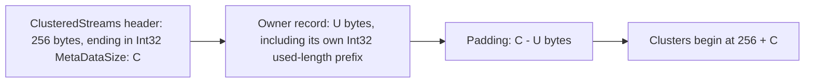
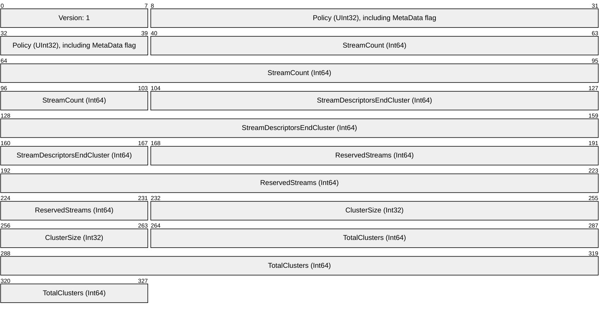
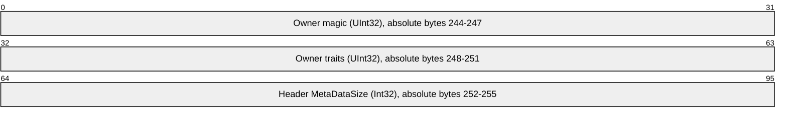
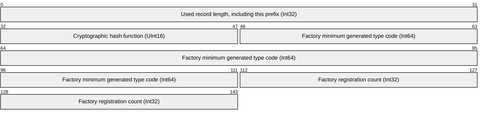
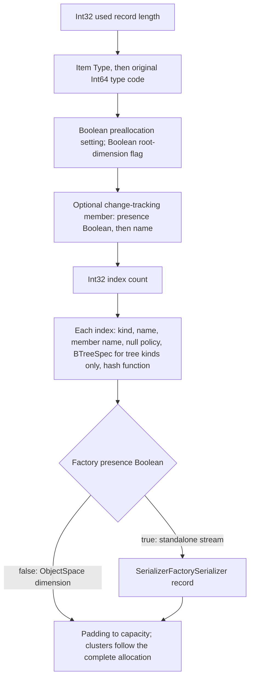

# Self-describing ObjectSpaces and ObjectStreams

Metadata lets a stored ObjectSpace reconstruct its builder configuration without
a supplied definition. The ObjectSpace stores its serializer factory once; each
dimension's ObjectStream describes its own item type, indexes and change tracking.
A standalone ObjectStream stores its factory in its own record.
The records are ordinary binary serialized classes stored in the existing
ClusteredStreams metadata region. There is no additional ObjectSpace or
ObjectStream prefix or header class on disk.

Use `.StoreMetaData()` on the ObjectSpace builder or `storeMetaData: true` on the
raw ObjectStream constructor. Ordinary creation keeps the legacy supplied-schema
layout. Metadata consumes no reserved clustered stream.

## Clustered layout

The fixed ClusteredStreams header remains **256 bytes**. Its existing version
stays **1**, with or without metadata. `ClusteredStreamsPolicy.MetaData` in the
header's Policy DWORD indicates an opaque metadata allocation after the header.
For these stores, the header's final DWORD, `MetaDataSize`, records the allocated
capacity and leaves **211 extension bytes**. Stores without metadata retain all
**215 extension bytes** and start their clusters at byte 256.

| Byte offset | Bytes | Field when the metadata flag is set |
|---|---:|---|
| 0 | 252 | Existing header fields and owner extension fields |
| 252 | 4 | Header `MetaDataSize`: allocated metadata capacity `C` (Int32) |
| 256 | `U` | Owner record; its first Int32 contains its used length `U`, including that Int32 |
| `256 + U` | `C - U` | Zero-filled padding |
| `256 + C` | Remaining bytes | Existing cluster map, stream descriptors and attachment/item streams |



The capacity and metadata-presence flag belong to ClusteredStreams. That layer
stores opaque bytes and does not interpret ObjectSpace types, traits, indexes or
the owner's record fields. `ClusteredStreams.Policy` retains the operational
allocation/cache options; `ClusteredStreams.Header.Policy` exposes the persisted
DWORD including the metadata-presence flag.
`HasMetaData`, header `MetaDataSize`, `MetaDataCapacity` and `DataOffset` expose
the generic layout. `ConfigureMetaData` selects the creation bytes and optional
capacity. `ReadMetaData()` reads the allocated blob directly; `WriteMetaData(bytes)`
checks its size and pads the unused capacity with zeros. These operations do not
create mapped-property proxies, grow the allocation or move clusters.

Capacity is an `int` with a default of `0`, which allocates exactly the serialized
record size when metadata is enabled. A positive value reserves an explicit
budget, for example `.StoreMetaData(64 * 1024)` for 64 KiB. Negative values are rejected.
A record larger than that budget is rejected before creation writes. Padding is
space for later explicitly supported changes; this feature does not implement
schema migration, metadata-region growth or adding dimensions to existing stores.

## Owner fields in the existing header

ObjectSpace and ObjectStream use the eight extension bytes before `MetaDataSize`
for their magic and traits, through the header's generic extension read/write
methods. Offsets are relative to the current container's start, including a child
ObjectStream stored inside an ObjectSpace.

| Absolute byte offset | Extension-relative offset | Bytes | Owner field |
|---|---:|---:|---|
| 244 | 203 | 4 | Magic (UInt32) |
| 248 | 207 | 4 | Traits DWORD (UInt32) |

The existing standard header fields and earlier extension bytes keep their
positions. The metadata-size DWORD belongs to ClusteredStreams; the preceding
eight-byte convention belongs to these owners. The standard fields occupy
bytes 0-40:



The final header fields are shown separately; the preceding extension bytes
retain their existing owner or caller mappings.



All header fields, capacity and owner records use the clustered store's byte
order. ObjectSpace magic is `ObjectSpaceStorageHelper.Magic`, UInt32 `0x5331304F`
(`S10O` in big-endian order). ObjectStream magic is
`ObjectStreamStorageHelper.Magic`, UInt32 `0x53313053` (`S10S` in big-endian order).
A raw opener reads the marker using the caller-supplied byte order, then verifies
that the owner's endian flag agrees. The caller retains the store's endianness
as external configuration; opening does not detect or infer it from the bytes.

ObjectSpace stores its complete `ObjectSpaceTraits` DWORD: `Merkleized` = 1,
`AutoSave` = 2, `GarbageCollect` = 4, `MetaData` = 8 and `BigEndian` = 16. Absence
of `BigEndian` records little-endian. `MetaData` requires a generic metadata
allocation on the ObjectSpace and every dimension ObjectStream.
ObjectStream's own flags are `MetaData` = 1 and `BigEndian` = 2.

Stores without metadata retain their cluster offset of 256. A supplied
configuration can still open them; opening does not insert a metadata allocation
or migrate the bytes. Direct opening without a definition requires recorded owner
metadata.

Owner configuration is captured when storage is created. Ordinary writes,
flushes, commits and rollbacks use the existing storage machinery and do not
recompute the record or relocate clusters. A new store rolled back to empty is
reinitialized on the same container using its original creation bytes. Deferred
file loading still permits configuration before first load. File and stream
ownership and the existing access-scope behavior remain unchanged.

## ObjectSpace record

`ObjectSpaceMetaDataSerializer` writes its Int32 used length, the cryptographic
hash function as UInt16, then the ObjectSpace's `SerializerFactory` through
`SerializerFactorySerializer`. The factory is stored once for all dimensions.
The hash function belongs to metadata, not the header. The record does not
duplicate child definitions or dimension count; count comes from the clustered
header's `StreamCount - ReservedStreams`.



The variable registration table follows this 18-byte fixed prefix. The complete
[serializer factory format](serializer-factory-serialization.md) describes its
registration and nested member records. It preserves original type codes,
declarative serializer construction, composite member order and wrapper settings.
Metadata storage calls the explicit codec directly; it does not resolve it
through the persisted factory or `SerializerFactory.Default`.

## ObjectStream record

`ObjectStreamMetaDataSerializer` begins with an Int32 used length, including that
prefix. It stores the item CLR type and its original Int64 type code, followed by
stream settings and indexes. A dimension's record omits its factory and uses the
ObjectSpace's saved factory. A standalone stream sets a presence Boolean and
serializes its factory through the same `SerializerFactorySerializer`.



Raw opening restores the saved factory, then resolves each recorded item type
and exact original code against it. It does not infer a replacement serializer
layout from the current CLR members. Automatic and declaratively configured
factories are supported. Captured delegates and independently configured
serializer instances have no reconstructible factory record and are rejected
before creation writes. CLR and serializer types referenced by the records must
remain available. This reconstructs the original configuration; it does not
perform schema migration.
Each index row has these fixed fields interleaved with its two optional names:

| Field | Encoding |
|---|---|
| Kind | Int32 |
| Name, then member name | Each uses a presence Boolean and, when present, a serialized string |
| Null policy | Int32 |
| BTreeSpec, for Identifier/UniqueKey/Index only | Int32 order, then Int32 type; 8 bytes total |
| Merkle hash function | UInt16 |

Each member index records one complete `BTreeSpec` containing its concrete tree
type and order. The builder has a complete default specification and resolves
each index before construction. Shared `WithIndexBTreeSpec`, `WithIndexBTreeType`
and `WithIndexBTreeOrder` settings replace that configuration;
an explicit per-index specification can describe a different layout for each
index. The ObjectSpace record does not duplicate these per-index values.

Reopening uses the recorded specification without choosing defaults again. The
index kind determines whether the eight specification bytes are present; there is
no presence flag. Recyclable-slot and Merkle attachments have no B-tree
specification and write no tree bytes. Merkle rows record
their configured hash function and recreate the existing Merkle attachment. The
ObjectSpace's root Merkle index uses the existing `FlatMerkleTree`. This
does not change the hash algorithm, Merkle calculation or index byte format.
Recyclable-slot indexes remain ordinary registered attachments.

## Create and reopen

The ObjectSpace builder's `.StoreMetaData()` method enables `ObjectSpaceTraits.MetaData`
when creating a new store. The raw-stream `ObjectStream<T>` constructor has the corresponding
`storeMetaData: true` argument. Both default to ordinary storage without metadata;
the existing constructor accepting `ClusteredStreams` and an explicit serializer
remains available. Opening an existing store reads its owner marker and metadata
flag using the supplied endianness, independently of this creation option. The
ObjectSpace definition's metadata trait reflects the actual stored layout on
reopen. Enabling the option
does not add metadata to existing legacy bytes.

```csharp
var endianness = Endianness.LittleEndian;
using var raw = new MemoryStream();
using (var space = new ObjectSpaceBuilder()
	.StoreMetaData()
	.UseMemoryStream(raw)
	.WithEndianness(endianness)
	.AddDimension<StoredItem>(true)
		.WithIdentifier(item => item.Id)
		.Done()
	.Build()) {
	space.Save(new StoredItem { Id = 17, Name = "stored" });
}

raw.Position = 0;
if (ObjectSpace.TryOpenFromStream(raw, endianness, out var opened)) {
	using (opened) {
		var item = opened.Get((StoredItem value) => value.Id, 17L);
	}
}

public sealed class StoredItem {
	public long Id { get; set; }
	public string Name { get; set; }
}
```

`ObjectSpace.TryOpenFromStream(rawStream, endianness, out objectSpace)` starts at
the stream's current position and requires `ObjectSpaceTraits.MetaData` in the
owner header. The caller supplies the store's original endianness; a mismatching
owner magic or endian flag returns `false`.
It scans the ObjectSpace record and each dimension's ObjectStream record to
rebuild the normal `ObjectSpaceBuilder` configuration, including serializers,
settings and the exact index order and names. After scanning, it resets to the
selected store origin and uses the existing loading path. The caller does not
supply an ObjectSpace definition.

`ObjectStream.TryOpenFromStream(rawStream, endianness, out objects)` similarly
opens a loaded standalone ObjectStream from its recorded configuration using the
caller-supplied byte order. A legacy stream, absent
metadata or an explicitly invalid header returns `false` with a null store.
I/O and deserializer exceptions propagate. Both methods borrow the supplied
stream; dispose the returned store before reopening that stream.

The internal `ObjectSpaceStorageHelper` and `ObjectStreamStorageHelper` own
metadata scanning, storage preparation and validation. Metadata parsing stays
outside the builder; its existing configuration methods construct the store.
`ObjectSpaceMetaData` and `ObjectStreamMetaData` hold state
only, with `Index` nested in the stream record. The explicit
`ObjectSpaceMetaDataSerializer` and `ObjectStreamMetaDataSerializer` encode and
decode those records through primitive and nested component serializers. Complex
codecs are instantiated when needed and own their complex child codecs; basic
singleton serializers are accessed directly rather than cached in fields.

The factory and both metadata codecs are registered in `SerializerFactory.Default`.
These added registrations shift automatically assigned application type codes.
Legacy stores require their original serializer factories and type/code mappings;
opening them does not migrate those mappings to the current defaults.

Supplied definitions remain supported. Reopening metadata storage with one must
validate its metadata owner header, including when the ObjectStream item type is
supplied directly; corrupt owner framing cannot select a legacy loading path. It must
preserve the recorded factory, dimension root and tracking settings, and each
index's physical order, name, member, null policy and complete B-tree specification.
`ObjectSpace.Traits` supplies the runtime flags. Public `AutoSave` and protected
`HasGarbageCollection` are boolean wrappers that read and update their flags;
they do not keep separate cached booleans.

Raw opening uses the seekable, writable stream it receives. Transaction page
settings, cache budgets and staging directories remain runtime choices of
`FileObjectSpace`; opening a committed file as a raw stream does not recreate
its transactional wrapper. Existing file commit and rollback behavior remains
with that wrapper.

Custom comparer configuration and delegate change tracking are not persisted by
this format. Serializer factories with captured delegates or independent mutable
serializer state also require the legacy supplied configuration. The
garbage-collection trait and each dimension's
root setting are reconstructed normally; the existing experimental collector's
reference-persistence limitations remain unchanged. Metadata describes construction;
it is not a schema migration mechanism.

The packet diagrams use [Mermaid's packet syntax](https://mermaid.js.org/syntax/packet.html)
(Mermaid 11 or later).
