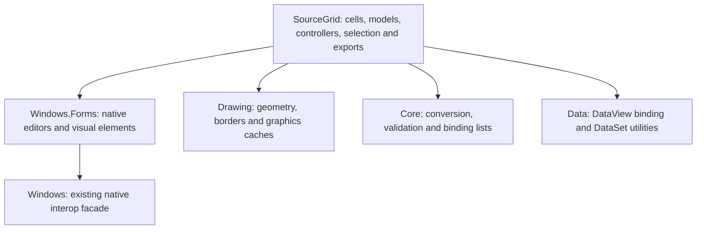

# SourceGrid and reusable desktop components

SourceGrid is the low-level grid engine. VisualGrid composes that engine with
Framework data sources, paging, settings and application editing behavior. The
Tester demonstrates them separately: **Data And Collections > SourceGrid > Raw
Grid Engine Gallery** opens the engine showcase.

## Choosing the presentation layer

| Requirement | Reuse |
|---|---|
| Process, service, module, event or other entity inventory | VisualGrid with IDataSource; keep paging, filtered totals, selection, row commands and export ownership together |
| A child table or image/editor panel below an entity | VisualGrid.RowDetails; its internal SourceGrid linked-control/span composition already handles native row mapping |
| A document or matrix with section headings, merged cells and heterogeneous cell roles | SourceGrid directly, as for a hierarchical system information report |
| Custom cell models, views/controllers, cell spans or non-entity matrix interaction | SourceGrid's existing cell/model/controller composition; study the raw engine gallery before creating another widget |
| Byte inspection or ordinary time-series charts | Existing HexEditorControl or GraphChart/TelemetryChart, rather than building another renderer from grid cells |

Using SourceGrid directly does not supply a diagnostic data source, a collector or
a paging/export policy. Keep expensive preparation on workers and retain the
screen's existing resource and settings owner. If an entity-table requirement is
missing, extend VisualGrid's reusable composition instead of bypassing its row
identity, filtering or native-input contracts in one application.

## Component ownership

The `SourceGrid` namespace retains the grid-specific APIs. General helpers have
their own owners rather than requiring a dependency on a grid implementation.

| Capability | Current API or owner |
|---|---|
| Type conversion, including custom converters | `TypeChanger.ChangeTypeUsingTypeConverter` |
| Validators and generic binding lists | `Sphere10.Framework.ComponentModel` |
| DataView binding | `Sphere10.Framework.Data.BoundDataView` |
| Calendar month/year differences | `Tools.Time` |
| DataSet expressions, sampling and XML/binary persistence | `Tools.Data` |
| Fixed-width record editor context | `Sphere10.Framework.Windows.Forms.Text.FixedLength` and native `Tools.FixedLength` |
| Borders, padding and fractional rounded rectangles | `Sphere10.Framework.Drawing` |
| Native visual elements | `Sphere10.Framework.Windows.Forms.Drawing.VisualElements` |
| Typed text and combo editing | Existing `TextBoxEx` and `ComboBoxEx`, with optional validators |
| Rich-text values, conversion and editing | Native `RichText`, `RichTextConversion` and `RichTextBoxEx` |
| Exception presentation and shell operations | Existing `ExceptionDialog` and `Tools.Windows.Shell` |
| Legacy DES encoding | Existing `Tools.Crypto` / `Encryptor` owners |
| Enveloped XML signatures | `Sphere10.Framework.Windows.Forms.XmlDigitalSignature` |

Source files follow their domains. A widget with dedicated supporting types has
its helpers at the domain root and its visuals under `Controls` or `Forms`.
Extensions use `Extensions`; shared helpers without a specific domain use `Misc`.
Physical folders do not change CLR namespaces or persisted control names.

The fixed-length field domain is owned by `Sphere10.Framework.Windows.Forms`.
Reference that project/package and use
`Sphere10.Framework.Windows.Forms.Text.FixedLength` for `IField`, `Field`,
`FieldList`, record attributes, parsers, writers and their exceptions.
`Tools.FixedLength` remains the discovery facade in that same assembly. These
types no longer reside in Core or `Sphere10.Framework.Text.FixedLength`.

## Typed imported APIs

Deletion notifications retain the source item's type:

| Producer | Public event arguments |
|---|---|
| `BoundList<T>` / `BoundListBase<T>` | `ItemDeletedEventArgs<T>` |
| `BoundDataView` | `ItemDeletedEventArgs<DataRow>` |
| `IBoundList`, consumed by the nongeneric native grid | `ItemDeletedEventArgs<object>` |

Events use the standard `EventHandler<TEventArgs>` delegate; the former bespoke
`ItemDeletedEventHandler` and nongeneric `ItemDeletedEventArgs` are removed.
`Item` remains mutable. Typed subscribers run first, then the explicit binding
interface subscribers receive the current item. Valid item replacements flow
back to the typed event arguments after binding handlers return. Subscribe to
the concrete source for typed items or to `IBoundList` at the heterogeneous
binding boundary. These are separate notification channels; the old arbitrary
interleaving of subscriptions made through both views is not retained.
`BoundDataView` deletion carries the actual `DataRow`, not its `DataRowView`.

`ListEditor.List` accepts `IList`, including ordinary `List<T>` instances. It
retains and edits the caller's list; `ItemType` still supplies its runtime schema.
Existing `ArrayList` inputs remain accepted. Code that assumed the property
returned an `ArrayList` should use the list interface instead. The gallery uses
a typed `List<SourceGridGalleryRow>`.

`ColumnInfoCollection` supports `IEnumerable<ColumnInfo>` while retaining
nongeneric enumeration. Selection column indexes use typed integer storage.
HTML's protected `EmbeddedImagePaths` cache is now `Dictionary<Image, string>`;
subclasses using its old `Hashtable` API need updating and rebuilding. Image
reuse, exported paths and caller ownership of images are preserved.

`FieldList` uses the Framework's generic dictionary decorator. Its keys and
values are live typed collection views, and `Remove(string)` returns a Boolean.
Missing lookups still return null; null fields remain invalid. Field lookup,
reference identity checks and declared-position ordering retain their behavior.

`CellCollection` uses typed cell storage and implements `IList<ICellVirtual>` and
`IReadOnlyList<ICellVirtual>`. Its integer indexes, `Capacity`, null rejection and
public removal behavior remain; its enumerator is generic and disposable.
`ControlsRepository` exposes `IReadOnlyDictionary<Guid, Control>` with live typed
key/value views. Adding a control attaches it to the supplied parent; removing
it detaches without disposing the borrowed control. Its existing `Clear`
behavior clears only the mapping and leaves the parent's controls attached.
Replace casts to `CollectionBase`, `DictionaryBase` or their nongeneric mutation
interfaces with the corresponding typed APIs, then rebuild consumers.

Runtime `TypeConverter` standard values and the native grid's heterogeneous
value/controller contracts retain their required object-based boundaries.
Genericizing those boundaries as `object` would add syntax without providing
typed values to their consumers.

## Engine gallery

The seven tabs exercise the real controls and data models:

1. **Cells & Editors**: typed editors, validation, cell spans, images, rich text, actions and selection.
2. **Object Binding**: editable typed rows, sorting and conditional cell views.
3. **DataView Binding**: DataTable-backed editing, commit and cancellation.
4. **Virtual Array**: a ten-thousand-row array using shared virtual cells.
5. **Planning**: appointments over a three-day range.
6. **Ping Data**: property-backed values and ascending/descending sorting.
7. **List Editor**: its native add, remove, move and refresh commands.

Selection and engine events appear in the gallery's event log. Export tools use
the existing CSV, HTML, bitmap and print implementations. Bitmap and print
previews explicitly limit large virtual sources; text exports cover the complete
source. CSV uses the Framework's shared escaping rules while retaining the
existing convention of flattening embedded line breaks. HTML honors its
`CellImages` flag.

## Resource and data contracts

Editors own the native controls they create. Dispose application-created editors
after their use ends. `ListEditor` releases the editors it creates while retaining
borrowed replacements supplied through its `Editors` property. Resetting the
gallery ends editing and releases its own editor instances.

Print documents release their original header, title and footer fonts; caller
replacement fonts remain borrowed. Rich-text rendering uses an owned native
surface for each render, reads the actual RTF, and releases its formatting cache.

DataSet binary persistence retains its existing version-one framing and field
encodings, including length prefixes, OADates, decimal words and null markers.
DataSet read/write helpers leave caller streams open. Exact reads reject truncated
payloads. This is independent of ObjectSpace storage metadata.

The original SourceGrid and DevAge authors, Davide Icardi and Darius Damalakas,
are acknowledged in the relevant code headers, including extracted helpers.

## Native controls in VisualGrid row details

`VisualGrid.RowDetails` composes the absorbed engine's existing `LinkedControls`
with a real spanned cell immediately below an entity. `ColumnSpan` makes the
child fill the table's columns; link positions follow one physical/entity-row
layout during paging, sort and reorder. Surviving controls keep their native
parents and handles. The old `Cells.CellControl` class is obsolete and is not
used for this feature.

Every expansion creates native control resources, so use the shared control
budget, depth bound, value-state retention limit and lazy worker preparation.
Prefer a table with a bounded scrollable child panel over rendering thousands
of native subcontrols at once. This mechanism is appropriate when the child
must be a real interactive panel; ordinary text/image cells should remain
prepared cells. SourceGrid rows and cell heights themselves are not a second
data model. Product code uses `VisualGrid`'s public descriptor and never maintains
its own physical-row mapping or reaches into the engine to install controls.

## Source naming migration

The absorbed code follows Framework member naming. Subclasses that used the
following protected fields must update their references and rebuild; compiled
subclasses also need rebuilding.

| Previous field | Current field |
|---|---|
| `m_Mode` | `ExportMode` |
| `m_Stream` | `OutputStream` |
| `m_ImageFullPath` | `ImageFullPath` |
| `m_ImageRelativePath` | `ImageRelativePath` |
| `m_EmbeddedImagesPath` | `EmbeddedImagePaths` |
| `m_MouseDownPosition` | `MouseDownCellPosition` |
| `m_MouseCellPosition` | `MouseOverCellPosition` |
| `m_HiddenRowsCoordinator` | `HiddenRowCoordinator` |
| `m_rows` | `GridRows` |
| `m_totalHiddenRows` | `TotalHiddenRows` |
| `m_rowMerger` | `HiddenRowRanges` |

Two protected notification hooks also follow normal method naming:

| Type | Previous method | Current method |
|---|---|---|
| `SourceGrid.DataGrid` | `mBoundList_ListChanged` | `BoundListChanged` |
| `SourceGrid.Extensions.PingGrids.PingGrid` | `mBoundList_ListChanged` | `BoundListChanged` |

Update overrides and calls to those hooks, then rebuild the subclasses. The two
public constant names below changed while retaining their values:

| Previous constant | Current constant |
|---|---|
| `RangeData.RANGEDATA_FORMAT` | `RangeData.RangeDataFormat` |
| `Position.c_EmptyIndex` | `Position.EmptyIndex` |

Legacy prefixed parameter names now use descriptive camelCase. Calls using named
arguments must use the corresponding current parameter names. Positional calls
retain their argument order and types. Persisted format strings and numeric
constant values are preserved.

