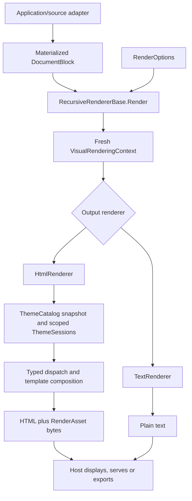

<!-- Copyright (c) Herman Schoenfeld 2018 - Present. Author: Herman Schoenfeld. Distributed under the MIT software license; see LICENSE. -->

# VisualRenderer design and extension guide

Sphere10.Framework.Web.VisualRenderer turns a materialized visual document into HTML and an in-memory resource bundle, or into plain text. Its central boundary is the visual model: source applications resolve their data, links and behavior before invoking the renderer. The rendering library owns output composition and presentation. The host owns displaying, serving or writing the result.

This guide explains the implementation and how to change it. Use the [rendering guide](renderer.md) for consumer setup, the [object-model reference](object-model.md) for individual fields, and the [theme guide](renderer-themes.md) for template authoring details.

## Ownership and terminology

| Concern | Owner | Example |
| --- | --- | --- |
| Reading source records, repositories and remote services | Application or source adapter | A LocalNotion adapter reads a page and resolves its children. |
| Source-specific controls and publication rules | Application or source adapter | CMS Tags decide whether a header is shown or contained-page references are hidden. |
| A finite, source-independent document | Visual model | `DocumentBlock`, `ParagraphBlock`, `ReferenceBlock`, resolved URLs and scalar metadata. |
| HTML/text behavior supported by the visual model | Renderer | A document's `HideEmbeddedPages` policy controls contained-page references in HTML. |
| Templates, styles, scripts, component layout and colors | Themes | `default`, `cms`, `bullet_check`, `header_large`, or an application's own modifier. |
| Filesystem or HTTP output, navigation base and browser integration | Host application | Serve each returned `RenderAsset` at its declared URL. |

A **Theme** is an ordered selection of named template/resource definitions. A **Tag** is a source application's control or classification value. They are different concepts even when an application exposes both through similarly named CMS fields. VisualRenderer has no CMS Tag collection and does not recognize Notion property names. A source adapter interprets a behavioral Tag and sets an explicit model property; it must not add that Tag to `DocumentBlock.Themes` merely to implement behavior.

For example, LocalNotion's `@HideEmbeddedPages` Tag projects to `DocumentBlock.HideEmbeddedPages`. The document still selects ordinary presentation Themes such as `default`. A template that styles an embedded-page reference is a separate presentation concern. Categories, keywords, publication status and access policy also remain source/application concerns; hiding a reference does not make its destination private.

The renderer targets .NET 10 and is independently packaged under the MIT License. It has no Sphere10 Framework, Notion SDK, LocalNotion repository or AngleSharp runtime dependency. Tests may use an HTML parser without adding it to the library's runtime boundary.

## Repository map

Paths below are relative to the repository root.

| Area | Main responsibility |
| --- | --- |
| [`src/Sphere10.Framework.Web.VisualRenderer/Model`](../../src/Sphere10.Framework.Web.VisualRenderer/Model) | Data records for blocks, inlines, property values and metadata. |
| [`IRenderer.cs`](../../src/Sphere10.Framework.Web.VisualRenderer/IRenderer.cs), [`RenderOptions.cs`](../../src/Sphere10.Framework.Web.VisualRenderer/RenderOptions.cs) | Public invocation and output options. |
| [`RecursiveRendererBase.cs`](../../src/Sphere10.Framework.Web.VisualRenderer/RecursiveRendererBase.cs) | Per-call setup, typed dispatch and shared recursion hooks. |
| [`VisualRenderingContext.cs`](../../src/Sphere10.Framework.Web.VisualRenderer/VisualRenderingContext.cs), [`VisualTraversal.cs`](../../src/Sphere10.Framework.Web.VisualRenderer/VisualTraversal.cs) | Active ancestry, indices, anchor allocation and finite traversal. |
| [`Html/HtmlRenderer.cs`](../../src/Sphere10.Framework.Web.VisualRenderer/Html/HtmlRenderer.cs) | HTML composition, typed output, template tokens and resource aggregation. |
| [`Text/TextRenderer.cs`](../../src/Sphere10.Framework.Web.VisualRenderer/Text/TextRenderer.cs) | Plain-text representations of the same model. |
| [`Themes/ThemeCatalog.cs`](../../src/Sphere10.Framework.Web.VisualRenderer/Themes/ThemeCatalog.cs) | Embedded/physical definitions, snapshots, ordered cascade and asset bundles. |
| [`Themes/ThemeSession.cs`](../../src/Sphere10.Framework.Web.VisualRenderer/Themes/ThemeSession.cs) | Template lookup and bounded token/include expansion. |
| [`Themes`](../../src/Sphere10.Framework.Web.VisualRenderer/Themes) | Embedded configurations, templates, includes and runtime resources. |
| [`tests/Sphere10.Framework.Web.VisualRenderer.Tests`](../../tests/Sphere10.Framework.Web.VisualRenderer.Tests) | Model rendering, theme, asset, isolation and compatibility regressions. |

The source project embeds theme files through its embedded-files manifest. Editing a source template changes a newly built assembly. It does not replace an application's already extracted override or a stylesheet already published at a CDN URL.

## The visual model is the integration boundary

There are three related hierarchies:

- `VisualNode` represents document structure: documents, headings, paragraphs, containers, lists, media, references and databases.
- `VisualInline` represents rich text inside a block: text, equations, people, dates, badges and inline references.
- `VisualValue` represents database/property cell values: text, numbers, booleans, dates, choices, files, references and compound/computed values.

These are separate hierarchies, not interchangeable wrappers. A `DocumentBlock` derives directly from `VisualNode` and owns its `Children`, `Tokens` and named `Slots`. Many ordinary blocks derive from `ContainerVisual`; lists, columns, tables and databases also have dedicated typed collections. Preserve those relationships when extending traversal.

The records use init properties and arrays for ordered content. Records do not make the contents of arrays or dictionaries immutable. Finish materializing them before rendering and do not mutate them while another call is using them. The renderer can isolate its own per-call state; it cannot provide a coherent snapshot of a model that a caller is concurrently changing.

`Metadata.SourceId` is opaque provenance. `Metadata.Anchor` is the DOM identity requested for a rendered occurrence. The context uses the explicit anchor, then the source ID, then an invocation-local `visual_1`, `visual_2`, … fallback. Give independently repeated source occurrences suitable identities instead of assuming a source identifier always identifies one HTML occurrence. Preserve existing anchors when changing presentation so authored fragment links keep working.

Links and media are already resolved data. A `Reference` carries its label, URL, availability and icon; it is not a repository handle. `TableOfContentsBlock.Entries` are supplied entries, not a request for a source lookup. Unknown source types can become `UnsupportedBlock`/`UnsupportedValue` with a prepared fallback or diagnostic. Do not add source-service callbacks, lazy repository queries or Notion objects to these records.

### Explicit semantic behavior

Use a model property when the decision is a supported output behavior rather than a choice of markup styling. The current document controls include `RenderFrame`, `ShowPageHeader`, `TitleOnCover` and `HideEmbeddedPages`.

`HideEmbeddedPages` is an HTML policy for the nearest containing `DocumentBlock`. It suppresses only a `ReferenceBlock` marked `IsEmbeddedPage`. Ordinary block references, `ReferenceInline` values and authored text links remain visible. A nested document establishes its own policy, including the default `false`; it does not accidentally inherit a parent's hiding policy through a Theme selection. The destination document remains independently renderable. `TextRenderer` retains its normal reference output.

```csharp
using Sphere10.Framework.Web.VisualRenderer;

var document = new DocumentBlock {
	Title = "Service overview",
	Themes = ["default"],
	HideEmbeddedPages = true,
	Children = [
		new ReferenceBlock {
			IsEmbeddedPage = true,
			Reference = new Reference { Label = "Service details", Url = "/service-details" }
		},
		new ParagraphBlock {
			Text = [new TextInline { Text = "Read the architecture section", Url = "/service-details#architecture" }]
		}
	]
};
var htmlResult = new HtmlRenderer().Render(document);
var text = new TextRenderer().Render(document);
```

In HTML, the automatic contained-page reference is absent and the explicit architecture link remains. Plain text continues to represent the reference. There is no behavioral Tag string in the Theme list.

If a consumer previously encoded this policy as a Theme selection, migrate that source configuration explicitly to the behavioral control and model property. Do not teach `ThemeCatalog` to interpret Tags, silently reinterpret arbitrary Theme names, or remove independently owned override files as part of rendering.

## What happens during one render



1. `Render` rejects a null document and invalid mode/environment enum values, then supplies default options if necessary.
2. `RecursiveRendererBase<TOutput>` clones the renderer instance for the invocation and gives that clone a new `VisualRenderingContext`.
3. `HtmlRenderer.OnRenderingContextCreated` resets counters, scoped token/session dictionaries and the output asset dictionary, and takes a theme snapshot. `TextRenderer` does not load HTML themes.
4. Typed dispatch enters each block into the traversal context, calls the matching `Render(...)` overload, and leaves it in `finally`. Inline and property-value dispatch have their own typed overloads.
5. HTML template composition produces the final string. The renderer collects resources from Theme sessions used by the render and deduplicates them by `RelativePath`.
6. A surviving Mermaid runtime marker is resolved after final composition. The result returns HTML, sorted assets and any downstream-formatting preference.

One renderer instance may therefore render independent documents repeatedly or concurrently without sharing toggle counters, traversal ancestry, local tokens or asset dictionaries between calls. A subclass that introduces mutable state must initialize that state per invocation too: the base clone is shallow, so a new mutable reference field is not isolated merely by declaring it on a subclass.

### Finite traversal

`VisualTraversal` tracks the active containment path by reference identity. Entering an already active node is a containment cycle; nesting beyond 256 blocks also fails clearly. It removes the node on exit, so a node encountered outside its previous active path is not classified as a cycle. Property-value rendering separately guards active values and its nesting limit.

These guards are a final defense for materialized visual input. A source adapter still needs its own bounded graph traversal while fetching or projecting source objects. Rendering guards cannot bound remote queries that occur before the visual model exists.

### Snippets

`RenderSnippet` accepts one `VisualNode`. It wraps that node in a document with `RenderFrame = false` and `ShowPageHeader = false`, or copies those flags onto a supplied document. It then uses the same render lifecycle. A snippet is not a complete browser page and does not establish a new asset host: its consumer must load and serve the returned CSS/scripts as required.

## HTML composition and scope

`HtmlRenderer` renders typed values and blocks into named template slots. A heading chooses a heading template; a paragraph supplies its rich text and children; a database builds headers and aligned row/cell output. The model determines the content and behavior, while the chosen template determines its markup.

A document creates a scoped copy of the ambient scalar tokens. It adds its `Tokens`, renders its typed `Slots`, and then renders either page content or its children directly. `RenderFrame` decides whether that content also receives the outer page wrapper. `ShowPageHeader` controls whether the page-content/header composition is used; it is independent of whether the complete HTML frame is emitted.

An explicitly nonempty `DocumentBlock.Themes` array selects a new Theme session for that document. An empty array keeps the surrounding session (the initial session comes from `RenderOptions.Themes`). `TemplateBlock` offers the same scoped Theme/token mechanism for custom composition. The previous session and token dictionary are restored in `finally`, so one nested fragment cannot change a later sibling's presentation.

`TemplateBlock` is the preferred composition escape hatch when an application needs its own wrapper but can express the contents as existing visual nodes. Its `Slots` contain typed visual content; its scalar `Tokens` contain trusted presentation strings. Text output renders the typed slots rather than attempting to interpret HTML templates.

### Text, tokens and trusted markup

Ordinary text and rich-text spans are HTML-encoded by their render methods. URL attributes, cover CSS URLs, code source and template-local fragments have their own encoding/composition paths. Keep that responsibility at the point where the value's HTML context is known.

`ThemeSession.Expand` inserts local render tokens literally. This protects source text containing `{title}` or `{include://file.inc}` from being interpreted again as theme instructions; it does **not** HTML-encode a caller's scalar token. `DocumentBlock.Tokens`, `TemplateBlock.Tokens` and `RawHtmlBlock.Html` are trusted-output mechanisms. Use typed slots for ordinary source content, not unencoded source strings embedded into a markup token.

The standalone renderer returns its composed HTML without parsing or pretty-printing it. `SuppressFormatting` is a result flag for downstream consumers; it does not run an HTML cleanup stage inside this library.

### Covers and titles

Title ownership is a model decision; banner size and alignment are presentation decisions. When `TitleOnCover` is true, the normal body title is suppressed according to the document's title-ownership contract. A document may set this because a parent/custom frame owns its title even when it has no native cover. Testing only a title-plus-image example can miss a body-title regression elsewhere.

Use the existing header Theme family for header presentation. The default cover retains its shared stylesheet and full-height title wrapper; its native subtitle uses the normal outside location. The opt-in [`header_cover`](../../src/Sphere10.Framework.Web.VisualRenderer/Themes/header_cover) Theme supplies a flex-centered cover with a natural-height white title/Subtitle group and a definite height from `cover_height.inc`. Its default is `35vh`, matching the existing stock cover stylesheet; the shared `200px` minimum still applies.

Select an existing size modifier after `header_cover`. The modifiers keep their original `header_height.inc` classes for the CMS carousel and default cover, and supply a separate `cover_height.inc` for the opt-in cover:

| Theme | Existing `header_height.inc` | Opt-in `cover_height.inc` |
| --- | --- | --- |
| `header_tiny` | `h-15` | `15vh` |
| `header_small` | `h-25` | `25vh` |
| `header_large` | `h-75` | `75vh` |
| `header_full` | `h-100` | `100vh` |

For example, `Themes = ["cms", "header_cover", "header_large"]` selects a large centered cover without changing the default shared cover stylesheet or the existing carousel composition. These are presentation Themes, not behavioral Tags. Extend the established template/include composition, and check every component consuming a changed include. A page-specific layout requirement is not a reason to change shared cover CSS or invent a source-specific branch in `HtmlRenderer`.

The `header_cover` configuration sets the generic `page_subtitle_placement` token to `cover` in both environments. The HTML renderer uses that explicit presentation token only when an actual cover, `TitleOnCover` and a nonempty native `Subtitle` are all present. The selected Theme owns matching `page_cover_title.html` and `page_cover_subtitle.html` fragments, including the optional `{cover_subtitle}` slot. It does not rely on a Theme name check, HTML inspection or source-specific condition. Without the opt-in token, or without an actual cover/title-on-cover, the native subtitle retains its outside location.

Keep the native document `Subtitle` separate from body headings, Typed labels and carousel captions. A title-only opt-in cover centers its title; a title/Subtitle pair centers together and moves the title up within the group. When changing this composition, preserve the selected Theme's slot contract, the body-title suppression policy, stable title ID, legacy overrides and documents without covers. See the [theme guide](renderer-themes.md#page-covers-and-header-heights) for the concrete templates and selection rules.

## Theme loading has two distinct orders

Theme cascade order selects the effective files and tokens. Template candidate order then selects one template from those effective files. Debug them separately.

### Catalog, overrides and snapshots

`ThemeCatalog` reads built-in definitions from the assembly's `Themes` manifest. An optional `ThemeOptions.ThemesDirectory` supplies files at corresponding named-theme paths. A physical file overrides the matching embedded file, including an intentionally empty file; a missing file falls back to the assembly. The library does not create, rewrite or extract an override directory.

`CreateSnapshot()` materializes override bytes so multiple sessions can use a consistent view. `HtmlRenderer` creates a snapshot for each independent render. A snapshot catalog caches sessions by ordered Theme names, environment, mode and asset base URL. A caller rendering a consistent group can pass a pre-created snapshot catalog to `HtmlRenderer`; start a new snapshot to adopt later override edits. Direct sessions on a catalog backed by a mutable directory refresh independently.

Do not introduce a process-global mutable template dictionary to speed up one call. It would defeat independent overrides, repeatable renders and concurrent use. Cache immutable snapshots or immutable sessions at the existing boundary.

### Named Theme configuration and cascade

A custom named Theme needs a `.config.json` with `"type": "html"`. It can declare a base Theme, an online asset URL, environment-specific tokens and traits. Its effective online URL can inherit from the base; omitting the `online_url` property on a Theme with a CDN-backed base does not request local assets. For example:

```json
{
  "type": "html",
  "base": "default",
  "tokens": {
    "TableCssClass": {
      "offline": "table table-bordered",
      "online": "table table-bordered"
    }
  }
}
```

The cascade is deliberately ordered:

1. Load the first selected Theme's entire base chain, oldest base first, then that Theme's own definitions.
2. Overlay only each later selected Theme's **own** files and tokens, in selection order.
3. A later Theme does not reapply its base chain. Explicitly selecting a base later in the array does apply that base's own definitions at that position.

This lets a decorative modifier replace one include without resetting an earlier component, typography or carousel template. The origin of a file—disk or assembly—does not outrank another selected Theme's cascade priority. Exact path and token spelling use ordinal comparison, so preserve case across platforms.

Invalid names/configuration, unavailable Themes and cyclic base chains produce `ThemeException`. There is no silent replacement of a malformed selected override with a default.

### Template lookup order

For a widget named `paragraph`, read-only offline rendering tries these effective files in this order:

| Priority | Candidate |
| --- | --- |
| 1 | `readonly/paragraph.offline.html` |
| 2 | `readonly/paragraph.html` |
| 3 | `paragraph.html` |
| 4 | `paragraph.offline.html` |

Editable/online rendering substitutes the corresponding mode and environment names. A root-level override can therefore lose to an existing mode-specific file. Check the selected candidate before changing a broader Theme or adding CSS to compensate.

### Includes and token expansion

`{include://file.inc}` expands an effective text file; `{theme://resources/site.css}` resolves a resource URL. Theme configuration tokens may select distinct offline/online values and use invariant formatting. Render-local tokens take precedence and are inserted literally. `{{` and `}}` escape braces in template material.

Missing include/resource tokens and include/token cycles fail with `ThemeException`; expansion also has bounded depth/pass limits. An unknown ordinary placeholder can remain in output, so assertions should check required final attributes and text rather than merely checking that expansion returned a string. Template names and Theme names are single names, not arbitrary filesystem paths.

## Assets and online/offline output

`HtmlRenderResult` contains the HTML string and `RenderAsset` records. Each asset has a relative path, content type and read-only byte memory. The host must display/serve/export those bytes; the library neither writes the output files nor registers HTTP routes.

The catalog bundles effective asset paths and bytes beneath a SHA-256 namespace such as `assets/{hash}/resources/...`. Hashing covers both paths and bytes, so different resources cannot overwrite an earlier document's bundle. Whole effective asset subtrees are retained, including dynamically requested fonts, language grammars and script modules; copying only the CSS and JavaScript named directly in the HTML can break a page later in the browser.

In offline mode, resource references use the bundle beneath `RenderOptions.AssetBaseUrl`. In online mode, files whose owning Theme has an effective online URL use that URL. Inherited files retain their actual owning Theme's URL, and a Theme can itself inherit its URL from its configured base. Reading a file from a local override does not automatically disable its CDN ownership. A modifier with neither an online URL nor a URL-bearing base can deliver its own resources through emitted assets in either environment. Custom selections can consequently produce a mixed online/local result.

An assembly update cannot update an old file at a remote CDN URL. To adopt changed bytes, publish the corresponding resource there, use the intended hosted URL, or select a Theme that delivers the file through the emitted bundle. Previously extracted files are also ordinary overrides and can mask newly embedded fixes. The consumer must decide which owned overrides to refresh; the library must not overwrite independent user configuration.

Offline output is HTML plus a resource bundle, not necessarily a self-contained HTML file. External content images, video and social embeds retain their own network requirements. The host must choose meaningful `AssetBaseUrl` and content URLs for its actual browser base address.

### Browser behaviors

Templates can supply hooks and load JavaScript for browser features such as Typed headings, galleries, syntax highlighting and equations. C# rendering produces their markup/resources; a successful render does not prove that a browser loaded or executed them.

Mermaid is a useful example of an explicit runtime contract. A Mermaid `CodeBlock` emits encoded source and a runtime marker. Only a marker surviving final HTML composition causes the pinned internal `.mermaid` runtime to be loaded, once per render; a discarded slot cannot consume the runtime needed by a visible diagram. Its assets are returned in both online and offline mode. A dynamic snippet host must load those resources and explicitly initialize newly inserted diagrams; setting `innerHTML` alone does not execute scripts. See [Mermaid diagrams](mermaid.md) for hooks, fallback source, initialization and the pinned third-party notices.

## Plain text remains an independent output

`TextRenderer` walks the visual model directly and does not apply HTML Themes or run browser features. It emits textual representations for blocks, rich spans and database cells. Links can have a different textual representation from their visible HTML labels; code and Mermaid retain source text rather than executing it.

`PlainTextOverride` on a node or inline is an explicitly prepared replacement, including an empty string. Reference text also has its own prepared override. Preserve this distinction: `null` means use the normal representation, while `""` intentionally omits text. An adapter may need a text-specific projection when source links or downloadable resources are not yet available.

A new HTML behavior must not silently alter text output. Decide and test its text semantics explicitly, including whether a source adapter's prepared text override should win.

## Choosing the correct extension point

| Requested change | First place to work | Keep out of the change |
| --- | --- | --- |
| A CMS behavioral Tag, publication rule or source-link interpretation | Source adapter/application, projecting an explicit model decision | Theme names, source SDK objects or repository callbacks in the renderer. |
| A reusable semantic capability of the rendered document | Model property plus the relevant output renderer | A magic Theme name used as a hidden behavior switch. |
| A visual component's markup, color, typography or layout | A focused template/include/CSS modifier through the normal Theme cascade | Post-render string replacements or page-ID-specific exceptions. |
| A custom wrapper around existing content | `TemplateBlock` with typed slots and trusted scalar tokens | A new model type solely to carry one application's HTML. |
| A genuinely new kind of visual content | A model record and both renderer paths | An opaque source object concealed in a token. |
| A new browser runtime feature | Typed model signal, markup hook, resources and initialization contract | Assuming server-side rendering executes browser scripts. |
| Output paths, HTTP delivery or refreshing deployed overrides | Host/exporter | Filesystem writes inside `HtmlRenderer`. |

### Add or change a presentation Theme

Start from the component's current effective template, including its mode-specific variant and includes. Add a small named modifier with its own `.config.json` and only the files it owns. Select it after the base/component whose presentation it intentionally overrides. Do not reintroduce unrelated files merely because they exist in the base Theme.

Preserve required content slots, stable anchor IDs, runtime data attributes, accessibility controls and typed child wrappers. For example, an alternative checklist template must keep rich-text runs and nested children inside a shrinkable content wrapper; styling each span as a separate flex item changes wrapping behavior. A Mermaid wrapper must retain its source/display/error hooks and runtime token.

Test the modifier together with the component and other applicable modifiers, in both relevant environments/modes. A standalone template preview cannot establish correct cascade behavior when the real selection includes a carousel, custom wrapper or typography modifier. If assets changed, test the owning URL and emitted byte set as well as the HTML.

### Add a visual type

Add one model record with source-independent data and a clear containment contract. Extend typed dispatch and the corresponding protected overload in `RecursiveRendererBase<TOutput>`, then implement HTML and plain-text output. Check whether common child traversal, metadata/type-token extraction and any specialized parent handling need updating; declaring a property named `Children` does not automatically make every renderer traverse it.

For HTML, add the default template and required resource hooks. Define the node's encoded text, trusted markup and URL boundaries. For text, define ordering, separators, empty values and prepared overrides. Add tests for empty/ordinary/nested input, relevant malformed or cyclic input, fragments and interaction with existing Theme overrides. Update the [object-model reference](object-model.md) and [coverage guide](renderer-coverage.md).

Keep protected renderer hooks usable by existing subclasses. Changing the public record shape, template slot name, anchor allocation or existing overload behavior is an API/compatibility change, even when one consuming website still looks correct.

### Add or change an adapter

Keep source access outside this repository. Materialize bounded source content, preserve source identities, assign occurrence anchors, resolve final URLs and map source controls into explicit model behavior. A caller should be able to construct an equivalent visual document directly without the source product installed.

Test the adapter in its consuming application: links relative to final destinations, native child-page containment versus ordinary references, source metadata freshness, text projection, CMS composition and published route behavior belong there. Then run standalone renderer tests for any library changes. A renderer test using a hand-built document cannot prove that a CMS Tag was read correctly from its source schema.

## How to verify a change

Run the relevant fixture during development, then the library's complete test project before accepting a renderer behavior change. An explicit build revision avoids allocating a local build counter during ordinary verification:

```powershell
dotnet test tests/Sphere10.Framework.Web.VisualRenderer.Tests/Sphere10.Framework.Web.VisualRenderer.Tests.csproj -c Release -p:BuildRevision=0
```

Use the [README's package instructions](../../src/Sphere10.Framework.Web.VisualRenderer/README.md#pack-and-publish-the-package) when a consuming application needs a rebuilt package. Package creation, package installation and browser deployment are distinct operations; passing source tests does not establish that the consumer loaded the new assembly or that a website serves the new CSS.

| Change area | Useful existing regression fixtures | Evidence to add or preserve |
| --- | --- | --- |
| Model dispatch, state or containment | `RenderingIsolationTests`, `PlainTextRenderingTests` | Repeat/concurrent calls, cycles, nesting and unchanged text semantics. |
| Tokens, encoding or nested composition | `TemplateTokenRenderingTests`, `SnippetRenderingTests` | Literal braces/includes in source text, typed slots, restored sibling scope and final attributes. |
| Theme cascade or snapshot behavior | `ThemeCatalogTests`, `ThemeCascadeTests`, `EmbeddedThemeTests` | Later modifier order, first-base inheritance, empty overrides and prior-session immutability. |
| Document/page wrappers or title ownership | `DocumentStandardsRenderingTests`, `PageHeaderRenderingTests`, `ThemeCascadeTests` | Full documents versus snippets, missing covers, legacy templates, optional subtitles and title suppression. |
| Assets or browser features | `MermaidRenderingTests`, relevant HTML fixtures | Correct resource paths/bytes, dynamic dependencies, runtime deduplication and usable fallback content. |
| Rich text or layout wrappers | `BulletCheckRenderingTests`, `ContainerColorRenderingTests` | Linked multi-run text, nested children, narrow wrapping and color inheritance. |

Parser and string assertions establish markup/data contracts. They cannot establish actual banner geometry, loaded fonts, contrast over artwork, responsive column reflow, animation settling or SVG diagram layout. For changes affecting those behaviors, open the consuming application's real rendered page on desktop and a narrow viewport. Inspect the affected content below the first screen too. Pair saved screenshots with the actual URL, viewport and final DOM/style measurements; ready-state or decoded image flags alone do not prove painted pixels.

When a deployed page differs from a local render, trace the actual artifact chain before changing source again: selected Theme list → effective override/template → owning asset URL and bytes → built package → installed consumer → hosted HTML/assets → browser result. Record which stage was checked. Keep a rejected or transitional capture separate from a later settled capture, and do not treat a source-test pass as evidence for a different deployed artifact.

## Diagnosing common failures

| Observed result | Check first |
| --- | --- |
| A changed template has no effect | Physical override precedence, mode/environment candidate and selected modifier order. |
| HTML changed but styling did not | The resource's owning `online_url`, emitted bundle and actual served CSS bytes. |
| A nested component changes a later sibling | Restoration of Theme/token scope and new mutable renderer fields. |
| Literal `{color}` or `{include://...}` from article text becomes markup | Encoding at the typed render path and literal insertion of local tokens. |
| An expected ordinary placeholder remains unresolved | Whether the caller supplied it and the selected template still uses the supported token. |
| Offline diagrams/equations/fonts fail | Complete returned resources, their relative dependency tree and the host's asset base. |
| A source-specific control is being passed as a Theme name | Adapter/model behavior mapping and the source schema's separate Tag/Theme fields. |
| One consumer regresses after a broad layout fix | Legacy overrides, frame/title ownership, snippets, nested scopes and unchanged-page comparisons. |

Keep fixes at the layer that owns the decision. A durable change explains both the output it adds and the existing contracts it preserves.
