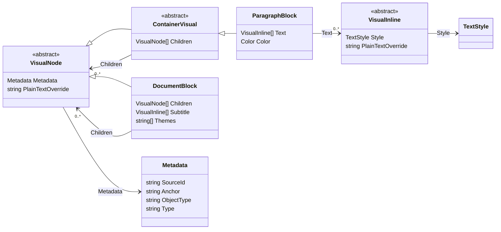
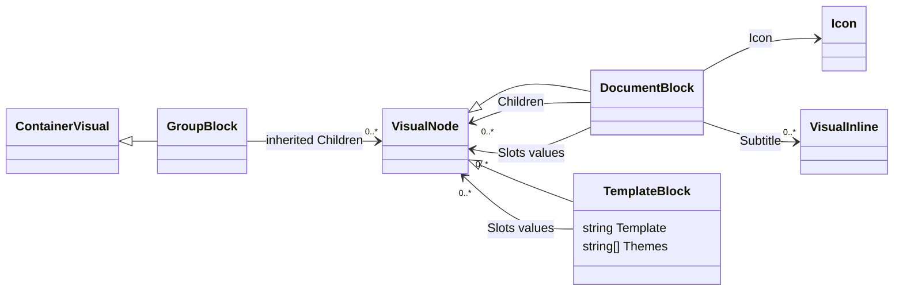
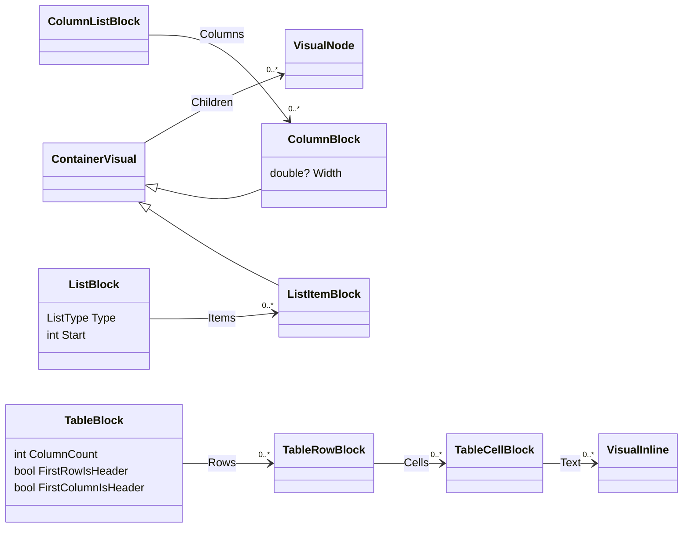
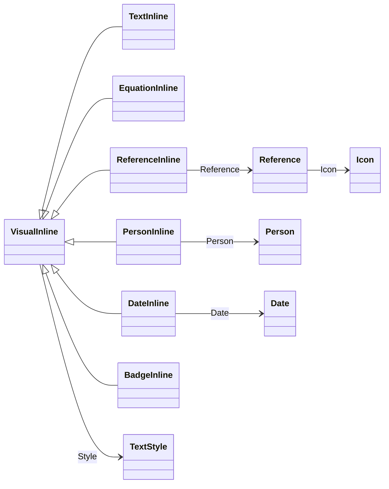
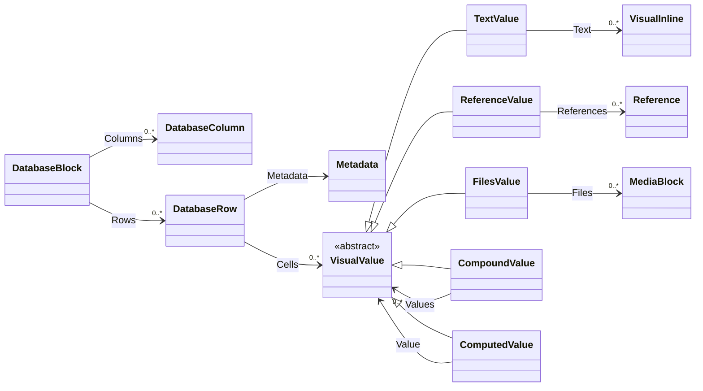

<!-- Copyright (c) Herman Schoenfeld 2018 - Present. Author: Herman Schoenfeld. Distributed under the MIT software license; see LICENSE. -->

# Visual object model

`Sphere10.Framework.Web.VisualRenderer` accepts a materialized visual document and renders it to HTML or plain text. Its model describes content, layout and presentation without a Notion SDK, repository, database connection or source-resolution service. The caller supplies final links, media URLs, labels and values before rendering.

This reference covers the public model in [`Model`](../../src/Sphere10.Framework.Web.VisualRenderer/Model), its rendering contracts and theme objects. Start with the [README example](../../src/Sphere10.Framework.Web.VisualRenderer/README.md#render-a-visual-document-to-an-html-string) for a complete document. See [rendering](renderer.md) for invocation and consumer integration, [themes](renderer-themes.md) for templates/assets, and [coverage](renderer-coverage.md) for source mappings and compatibility behavior.

## Model families and identity

There are three independent abstract record families:

| Root | Role | Shared members |
| --- | --- | --- |
| `VisualNode` | A block or structural element in the document tree | `Metadata`, `PlainTextOverride` |
| `VisualInline` | A span inside rich text | `Style`, `PlainTextOverride` |
| `VisualValue` | A typed database cell value | No common fields |

The arrows below distinguish **inheritance** (`<|--`) from **property references** (`-->`). Property references show containment or associated data, not exclusive ownership: records and their arrays can refer to other objects.

`DocumentBlock` inherits directly from `VisualNode`; it declares its own `Children`. `ContainerVisual` is the shared base for paragraphs, headings and other blocks with generic children. Lists, tables, columns and databases instead expose typed collections described below. `VisualInline` and `VisualValue` do not inherit from `VisualNode`.

`Metadata.SourceId` is opaque provenance. `Metadata.Anchor` is the identity of this visual occurrence, used for DOM anchors. `ObjectType` defaults to `"block"`; `Type` can supply a presentation discriminator. When no explicit anchor is supplied, the render context uses `SourceId`, then generates `visual_1`, `visual_2`, and so on. Give repeated source occurrences distinct anchors when their output must have distinct IDs; source identity alone does not make them unique.

`PlainTextOverride` is an optional, explicitly prepared text representation on nodes, inlines and `Reference`. `null` permits normal text rendering; an empty string deliberately suppresses that text. It does not replace HTML output.

The content types are records with init properties. Ordered content uses arrays; `Tokens` and `Slots` use keyed dictionaries. An init property does not make its referenced array or dictionary immutable. Finish constructing the graph before rendering and do not mutate shared inputs concurrently.

## Documents and template composition

`DocumentBlock` is the root accepted by `Render` and can also occur inside another document. Its properties are:

| Concern | Properties | Meaning |
| --- | --- | --- |
| Document information | `Title`, `Name`, `Description`, `Keywords`, `Author`, `CreatedTime`, `UpdatedTime` | Prepared title/content metadata; no source lookup is performed. |
| Page presentation | `Subtitle`, `Icon`, `CoverUrl`, `TitleOnCover`, `PageStyle` | Rich subtitle and optional icon/cover. `PageStyle` defaults to `"wide"`. |
| Structure | `Children`, `Slots` | Ordered main content and named typed composition slots. |
| Frame controls | `RenderFrame`, `ShowPageHeader` | Both default to `true`. `RenderFrame = false` omits the outer HTML document frame. `ShowPageHeader = false` renders children directly instead of the page-content/header wrapper. |
| Embedded-page visibility | `HideEmbeddedPages` | Defaults to `false`. HTML omits only automatic `ReferenceBlock` widgets marked `IsEmbeddedPage` within the nearest containing document. Nested documents have their own setting; text rendering is unchanged. |
| Theme composition | `Themes`, `Tokens` | Optional local theme selection and trusted scalar presentation values. |

`TemplateBlock.Template` names the template to render. Its `Slots` map names to typed nodes, `Tokens` map names to literal strings, and `Themes` can select local presentation. `GroupBlock` supplies only inherited children and renders their combined content. It is useful when one slot needs multiple nodes.

HTML renders slot nodes into named template tokens. Nested document/template theme and token scopes are restored after each node. Plain text renders a template's slot values rather than its HTML template; document text renders its title/name when the page header is enabled, followed by children.

**Ordinary text belongs in typed nodes/inlines.** `DocumentBlock.Tokens`, `TemplateBlock.Tokens` and `RawHtmlBlock.Html` are trusted presentation inputs inserted literally. They are not automatically encoded as ordinary source text. `RawHtmlBlock.Text` supplies that block's separate plain-text output. Select a custom template or override an existing renderer hook when a presentation cannot be expressed by the built-in nodes.

## Blocks and layout

Every type in the following table derives from `VisualNode`, either directly or through `ContainerVisual`. Shared `Metadata` and `PlainTextOverride` are omitted from the property lists.

| Type | Base | Own properties and purpose |
| --- | --- | --- |
| `DocumentBlock` | `VisualNode` | Document/frame/composition properties described above. |
| `TemplateBlock` | `VisualNode` | `Template`, `Tokens`, `Slots`, `Themes`: custom typed composition. |
| `GroupBlock` | `ContainerVisual` | No additional fields; groups inherited `Children`. |
| `ParagraphBlock` | `ContainerVisual` | `Text`, `Color`: rich paragraph and optional nested blocks. |
| `HeadingBlock` | `ContainerVisual` | `Level` (default 1), `Text`, `Color`, `IsToggleable`, `IsOpen`. Built-in HTML supports heading levels 1–3. Non-toggle HTML headings omit their children; text includes them. |
| `QuoteBlock` | `ContainerVisual` | `Text`, `Color`: quotation with nested content. |
| `CalloutBlock` | `ContainerVisual` | `Text`, `Icon`, `Color`: note with nested content. |
| `ToDoBlock` | `ContainerVisual` | `Text`, `Color`, `IsChecked`: task with nested content. |
| `ToggleBlock` | `ContainerVisual` | `Text`, `Color`, `IsOpen`: collapsible title and body. |
| `TabsBlock` | `ContainerVisual` | Ordered `TabBlock` children; static content enhanced with a browser tab bar. |
| `TabBlock` | `ContainerVisual` | `Text`, `Icon`, `Color`: panel label and inherited content children. See [tabbed content](tabs.md). |
| `ListBlock` | `VisualNode` | `Type`, `Start` (default 1), `Color`, `Items`: explicit list wrapper. |
| `ListItemBlock` | `ContainerVisual` | `Text`, `Color`: one item; nested lists belong in its `Children`. |
| `ColumnListBlock` | `VisualNode` | `Columns`: ordered layout columns. |
| `ColumnBlock` | `ContainerVisual` | `Width`: optional stored width; built-in rendering uses the column-count template rather than this value. |
| `TableBlock` | `VisualNode` | `ColumnCount`, `FirstRowIsHeader`, `FirstColumnIsHeader`, `Rows`: simple rich-text table. |
| `TableRowBlock` | `VisualNode` | `Cells`: ordered table cells. |
| `TableCellBlock` | `VisualNode` | `Text`: rich-text cell contents. |
| `CodeBlock` | `VisualNode` | `Code`, `Language` (default `CodeLanguage.Text`), `Caption`: literal code with syntax-highlighting language. `CodeLanguage.Mermaid` selects browser diagram rendering with retained source; see the [Mermaid guide](mermaid.md). |
| `EquationBlock` | `VisualNode` | `Expression`: display equation. |
| `DividerBlock` | `VisualNode` | No additional fields; visual/text separator. |
| `BookmarkBlock` | `VisualNode` | `Url`, `Title`, `Description`, `ImageUrl`, `IconUrl`, rich-text `Caption`: prepared web preview, with no renderer network/cache dependency. See [bookmarks](bookmarks.md). |
| `MediaBlock` | `VisualNode` | Media, caption and prepared embed-provider fields described below. |
| `ReferenceBlock` | `VisualNode` | `Reference`: a resolved block-level link. `IsEmbeddedPage` marks a contained page's parent-facing reference; defaults to false. |
| `BreadcrumbBlock` | `VisualNode` | `Items`: prepared ancestry links and current-page markers. |
| `TableOfContentsBlock` | `VisualNode` | `Color`, `Entries`: navigation marker plus optional prepared text entries. |
| `DatabaseBlock` | `VisualNode` | `Columns`, `Rows`: ordered typed records and values. |
| `RawHtmlBlock` | `VisualNode` | `Html`, `Text`: explicit trusted HTML and separate plain-text representation. |
| `UnsupportedBlock` | `VisualNode` | `Type` (default `"unsupported"`), `FallbackText`, `Diagnostic`: caller-prepared unsupported-content result. |

`ListType` is `Bulleted` or `Numbered`; the wrapper determines item presentation. Tables are not database grids: their cells contain rich text rather than `VisualValue`. The HTML column-list renderer has a deliberate 0–12 column limit, selecting `column_list_1` for an empty list and the corresponding count template otherwise. More than twelve columns throws rather than silently choosing a different layout.

`TableOfContentsBlock.Entries` is used by the text renderer. The current HTML renderer emits the selected theme's TOC template and color without rendering these entries; built-in browser scripts construct heading navigation. Do not assume populating `Entries` creates static HTML links.

## Rich text and shared descriptors

All rich-text arrays contain `VisualInline` values. The base carries `Style` and `PlainTextOverride`; each concrete inline adds its own payload.

| Inline | Own properties | Presentation |
| --- | --- | --- |
| `TextInline` | `Text`, `Url` | Ordinary text with an optional already-resolved link. HTML applies its `TextStyle`. |
| `EquationInline` | `Expression` | Inline mathematical expression. |
| `ReferenceInline` | `Reference` | Prepared page/entity link. |
| `PersonInline` | `Person` | Display name and optional email. |
| `DateInline` | `Date` | Date or range. |
| `BadgeInline` | `Text`, `Color` | Colored badge. |

The specialized renderers use their respective inline payloads; inheriting `Style` does not promise every specialized inline applies every text-style flag.

| Descriptor | Properties | Contract |
| --- | --- | --- |
| `TextStyle` | `Bold`, `Italic`, `Underline`, `StrikeThrough`, `Code`, `Color` | Flags default to false; color defaults to `Color.Default`. |
| `Reference` | `Url`, `Label`, `Icon`, `ShowIndicator`, `IsAvailable`, `PlainTextOverride` | Target is already resolved. `IsAvailable` defaults to true; an available empty URL can link to the current document. No target is recursively fetched or expanded. |
| `Icon` | `Emoji`, `Url`, `AltText` | Emoji or a prepared image URL. |
| `Person` | `Name`, `Email` | Detached display data; no source identity or lookup. |
| `Date` | `Start`, `End`, `TimeZone`, `IncludeTime` | Nullable `DateTimeOffset` endpoints; `IncludeTime` defaults to true. Formatting uses their supplied offsets; the stored `TimeZone` string does not perform timezone conversion. |
| `Choice` | `Label`, `Color` | One select/status label. |
| `BreadcrumbItem` | `Reference`, `IsCurrent` | One precomputed breadcrumb component. |
| `TocEntry` | `Level`, `Reference` | One prepared navigation entry; level defaults to 1. |

`Color` defines Default, Gray, Brown, Orange, Yellow, Green, Blue, Purple, Pink and Red, each with a corresponding `Background` member. Colors select named theme presentation rather than arbitrary CSS color values. `CodeLanguage` is the syntax-language enum; its members carry Prism identifiers, such as `CSharp` → `csharp`. Use the [enum source](../../src/Sphere10.Framework.Web.VisualRenderer/Model/CodeLanguage.cs) for the complete language list.

## Media and navigation

`MediaBlock.Type` is one of `MediaType.Image`, `Audio`, `Video`, `Pdf`, `File` or `Embed`. The block supplies `Url`, `FileName`, `AltText`, `Size`, rich-text `Caption`, `Provider` and `ProviderId`. The renderer does not download or discover content media; returned theme assets are a separate resource bundle.

`EmbedProvider` is `None`, `YouTube`, `Rumble`, `BitChute`, `Vimeo` or `Twitter`. Use `MediaType.Video` with `None` for a native video URL. YouTube, Rumble, BitChute and Vimeo use `ProviderId` with either `Video` or `Embed`; Twitter uses `MediaType.Embed` and the prepared `Url`. The HTML embed branch uses unsupported rendering when both `Url` and `ProviderId` are blank, or when its provider is `None`. Other unsupported provider combinations can throw `NotSupportedException`, including Twitter in the video-provider branch.

The media `AltText` field is retained by the model but is not forwarded by the current built-in image renderer. The default image template emits an empty `alt`; the CMS image template uses the rendered caption. Supplying `AltText` alone therefore does not change built-in image alternative text. Image icons use their separate `Icon.AltText` field.

`ReferenceBlock`, `ReferenceInline`, `ReferenceValue`, `BreadcrumbItem` and `TocEntry` reuse the same `Reference` descriptor. Preparing links once keeps rendering independent of repository paths and source identifiers. A breadcrumb's ancestry and availability are caller decisions, not a traversal of linked source pages.

Set `ReferenceBlock.IsEmbeddedPage` only for a page contained by the current document. Set `DocumentBlock.HideEmbeddedPages` to omit those automatic widgets from HTML within that document. The nearest containing `DocumentBlock` owns this behavior, so a nested document's default `false` does not inherit suppression from an outer document. This is an explicit model control, not a Theme name. Ordinary block references, authored text links and inline references remain visible, and an independently rendered destination keeps its body. The source adapter supplies the containment distinction and behavior; it must not infer containment from a URL, title or source identifier. Plain-text reference output is unchanged.

Visible embedded references still use the `embedded_page.html` presentation slot; its default `{contents}` preserves the existing block-reference markup. Custom Themes can style that slot through the ordinary template cascade. The standalone renderer does not interpret application-specific CMS Tags.

## Database records and values

`DatabaseBlock.Columns` defines the ordered schema. Each `DatabaseColumn` has `Key`, `Label` and a presentation `Type` string (default `"text"`). `DatabaseRow` has `Metadata` and an ordered `Cells` array aligned by index to that schema. Missing trailing cells render empty; the renderer does not infer a new schema from those cells. Supply one intended value per column when constructing records.

The diagram emphasizes structured values; the full `VisualValue` family is:

| Value type | Properties | Meaning |
| --- | --- | --- |
| `EmptyValue` | None | Empty cell. |
| `TextValue` | `Text` | Rich-text array. |
| `NumberValue` | `Number` | Nullable double. |
| `BooleanValue` | `Boolean` | Nullable boolean. |
| `DateValue` | `Date` | Date/range descriptor. |
| `PeopleValue` | `People` | Array of `Person`. |
| `FilesValue` | `Files` | Array of detached `MediaBlock` values. |
| `ChoiceValue` | `Choices` | Array of colored `Choice` labels. |
| `ReferenceValue` | `References`, `IsBlock` | Prepared links; `IsBlock` requests block instead of inline reference presentation in HTML. |
| `LinkValue` | `Url`, `Label` | Direct URL/email-style link with display text. |
| `CompoundValue` | `Values` | Ordered recursive values, such as a materialized array. |
| `ComputedValue` | `Value` | One already evaluated result, defaulting to `EmptyValue`. No formula or rollup computation occurs here. |
| `UnsupportedValue` | `Text`, `Diagnostic` | Prepared fallback and diagnostic for an unsupported value. |

## Rendering and theme API

These types consume the model or describe its output; they are not document children.

| Type | Public contract |
| --- | --- |
| `IRenderer<TOutput>` | `Render(DocumentBlock, RenderOptions)` and `RenderSnippet(VisualNode, RenderOptions)`. |
| `RecursiveRendererBase<TOutput>` | Abstract implementation with typed rendering hooks, recursion and a protected `RenderingContext`. Each render clones invocation state before dispatch. |
| `HtmlRenderer` | Concrete `RecursiveRendererBase<HtmlRenderResult>`; optionally accepts a `ThemeCatalog`. |
| `TextRenderer` | Concrete `RecursiveRendererBase<string>` for plain text. |
| `RenderOptions` | `Themes`, `Mode` (default `ReadOnly`), `Environment` (default `Offline`) and `AssetBaseUrl`. |
| `RenderMode` | `ReadOnly` or `Editable`, selecting the relevant template variants. It does not connect edits to an application/source persistence service. |
| `RenderEnvironment` | `Offline` or `Online`, selecting resource resolution and environment variants. |
| `HtmlRenderResult` | `Html`, `Assets` and `SuppressFormatting`; the latter records a theme's downstream formatting request. |
| `RenderAsset` | `RelativePath`, `ContentType`, `ReadOnlyMemory<byte> Content`; in-memory theme resources for the caller to serve or export. |
| `ThemeOptions` | Optional `ThemesDirectory` containing named file overrides. |
| `ThemeCatalog` | Loads embedded defaults/overrides, `CreateSnapshot()` freezes a consistent view, and `CreateSession(...)` selects ordered themes, environment, mode and asset base. |
| `EmbeddedThemes` | `OpenArchive()` opens the built-in ZIP as an independent read-only .NET `ZipArchive`; the caller disposes it and its entry streams. |
| `ThemeSession` | Read-only `Tokens`, `Assets`, `SuppressFormatting`, plus `GetTemplate(...)` and `Expand(...)`. |
| `ThemeException` | Reports invalid, unavailable or cyclic theme content. |
| `VisualRenderingContext` | Per-call `Document`, `Options`, `RenderingStack`, `CurrentRenderingNode`, `CurrentIndex`, `GetParentRenderingNode()` and `GetAnchor(...)`. |

`RenderSnippet` renders the supplied node without a document frame or page header. For a `DocumentBlock`, it renders the document's children in that mode. HTML snippets still need a host that loads the chosen styles/scripts.

Traversal state, generated anchors, counters, effective theme sessions and collected assets belong to one render invocation. The supplied model must be finite: recursive node containment or excessive depth throws, and recursive property values have their own guard. Separate calls can reuse a renderer without sharing traversal state, provided callers preserve their input objects.

To extend output, subclass `HtmlRenderer`, `TextRenderer` or `RecursiveRendererBase<TOutput>` and override the relevant typed rendering/template hooks. Existing concrete model records are sealed. New source concepts can usually project onto these types, `TemplateBlock`, or an explicit `UnsupportedBlock`; merely declaring a new `VisualNode` subtype does not add it to the base renderer's dispatch. Use a custom dispatch/unsupported hook when introducing such a type. Keep source access and business composition in the consuming application.
