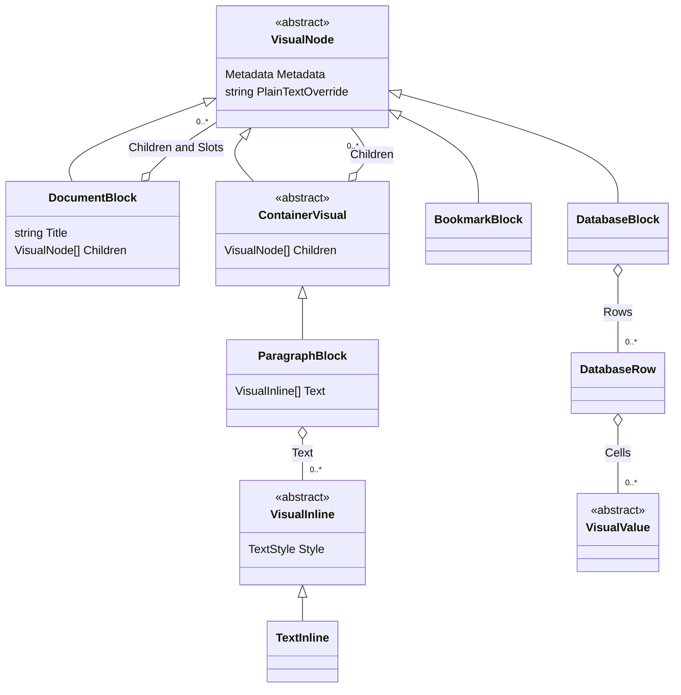
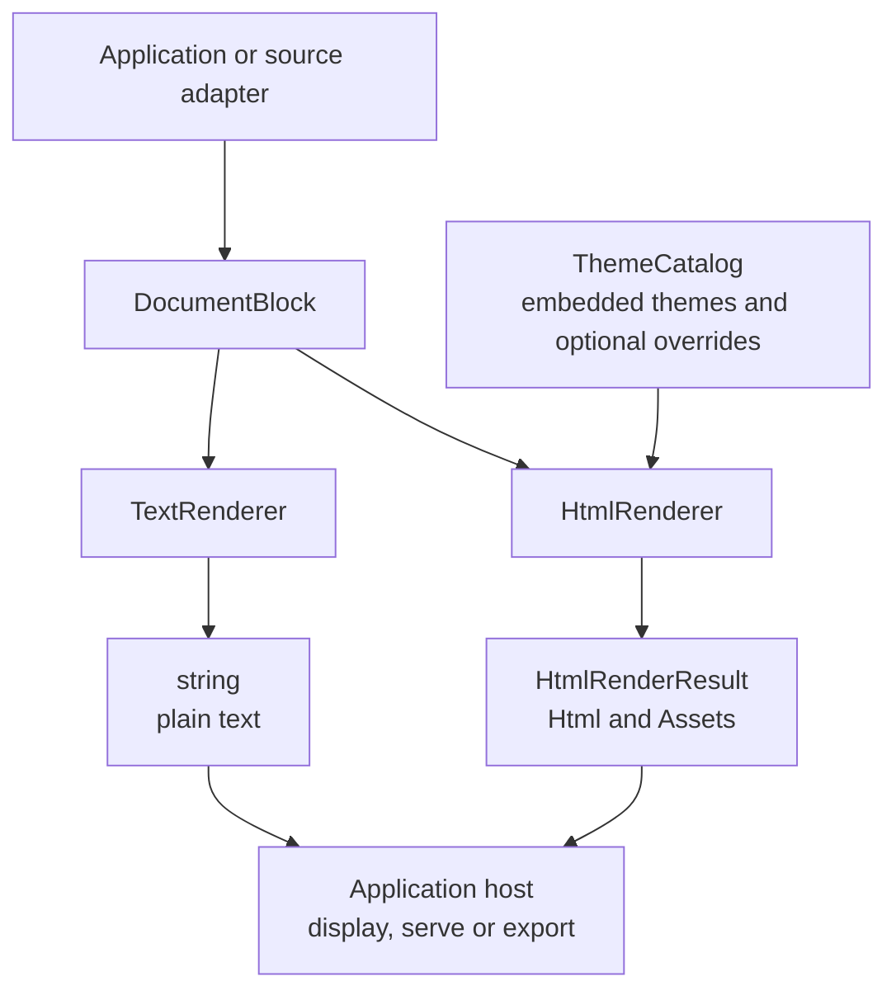

<!-- Copyright (c) Herman Schoenfeld 2018 - Present. Author: Herman Schoenfeld. Distributed under the MIT software license; see LICENSE. -->

# Sphere10.Framework.Web.VisualRenderer

Build a visual document in C# and render it to HTML or plain text. This [MIT-licensed](../../LICENSE) library is part of Sphere10 Framework. It targets Framework's supported .NET versions and runs independently of Notion, LocalNotion repositories and AngleSharp.

Templates and their defaults are packaged into one embedded ZIP at build time. In online mode, the built-in themes use absolute CDN URLs for stylesheets, scripts, and supporting assets. You can display the resulting HTML string in an embedded browser without deploying a themes folder or hosting asset files.

## Object model

The model separates document structure (`VisualNode`), rich-text spans (`VisualInline`) and database cell values (`VisualValue`). Applications construct these records directly or project their source data into them. Ordered arrays describe the content; links, media URLs and reference labels are resolved before rendering.



This overview shows representative types. `DocumentBlock` inherits directly from `VisualNode` and declares its own children and named slots. Lists, tables and columns use their own typed collections. `VisualInline` and `VisualValue` are separate hierarchies, rather than child nodes. The [full object-model reference](../../docs/visual-renderer/object-model.md) documents every model type, its fields and relationships, plus the renderer, theme and output contracts.

## Rendering flow

Both renderers accept the same visual model and `RenderOptions`. `HtmlRenderer` applies themes and returns HTML with any in-memory assets; `TextRenderer` returns a string without applying HTML themes. `RenderSnippet` accepts an individual `VisualNode` instead of a complete document.



The application owns source access and output delivery. Rendering performs no Notion lookups, network downloads or output-file writes. The [rendering guide](../../docs/visual-renderer/renderer.md) explains invocation and consumer integration; the [theme guide](../../docs/visual-renderer/renderer-themes.md) covers snapshots, inheritance, overrides and online/offline assets.

## Installation

Install from the NuGet feed containing the package:

```shell
dotnet add package Sphere10.Framework.Web.VisualRenderer
```

To build and consume a local package from this repository, see [Pack and publish the package](#pack-and-publish-the-package).

## Render a visual document to an HTML string

Create the renderer, choose online assets, and build the document directly:

```csharp
using Sphere10.Framework.Web.VisualRenderer;

var renderer = new HtmlRenderer();
var options = new RenderOptions {
	Themes = ["default"],
	Mode = RenderMode.ReadOnly,
	Environment = RenderEnvironment.Online
};
var document = new DocumentBlock {
	Title = "A document built in C#",
	Description = "Rendered directly from the visual object model.",
	Icon = new Icon { Emoji = "📄" },
	Children = [
		new HeadingBlock {
			Level = 1,
			Text = [new TextInline { Text = "Welcome" }]
		},
		new ParagraphBlock {
			Text = [
				new TextInline { Text = "This page was built from " },
				new TextInline { Text = "typed C# objects", Style = new TextStyle { Bold = true } },
				new TextInline { Text = ". Its styles and scripts load from online CDNs." }
			]
		},
		new ListBlock {
			Type = ListType.Numbered,
			Items = [
				new ListItemBlock { Text = [new TextInline { Text = "Build a DocumentBlock." }] },
				new ListItemBlock { Text = [new TextInline { Text = "Render it to an HTML string." }] },
				new ListItemBlock { Text = [new TextInline { Text = "Display the string in your browser control." }] }
			]
		},
		new CalloutBlock {
			Icon = new Icon { Emoji = "💡" },
			Text = [new TextInline { Text = "No Notion connection or local theme files are required." }]
		},
		new CodeBlock {
			Language = CodeLanguage.CSharp,
			Code = "Console.WriteLine(\"Hello from the visual model!\");"
		},
		new EquationBlock { Expression = "x^2 + y^2 = z^2" }
	]
};
var html = renderer.Render(document, options).Html;
```

The actual value of `html` is:

```html
<html lang="en">
<head>
    <meta charset="UTF-8">
    <meta http-equiv="X-UA-Compatible" content="IE=edge">
    <meta name="viewport" content="width=device-width, initial-scale=1.0">
    <meta name="description" content="Rendered directly from the visual object model." />
    <meta name="keywords" content="" />
    <meta name="author" content="" />
    <link rel="stylesheet" href="https://cdn.jsdelivr.net/gh/sphere10/cdn/local-notion/themes/default/resources/bootstrap/bootstrap.min.css" />
    <link rel="stylesheet" href="https://cdn.jsdelivr.net/gh/sphere10/cdn/local-notion/themes/default/resources/datatables/datatables.min.css" />
    <link rel="stylesheet" href="https://cdn.jsdelivr.net/gh/sphere10/cdn/local-notion/themes/default/resources/prism/prism.css" />
    <link rel="stylesheet" href="https://cdn.jsdelivr.net/gh/sphere10/cdn/local-notion/themes/default/resources/local-notion/css/ln.css" />
    <link rel="stylesheet" href="https://cdn.jsdelivr.net/gh/sphere10/cdn/local-notion/themes/default/resources/local-notion/css/readonly.css" />
    <title>A document built in C#</title>
</head>

<body class="ln-page-wide">
    <main>
        <section id="visual_1" class="ln-page-content pb-5  ln-color-">

    <div id="" class="container mx-auto mx-5">
        <span class="bottom-0" style="font-size: 5rem;">&#128196;</span>
        <h1 id="page-title" data-toc-skip class="mt-5 mb-1 mb-md-3 ln-color- ">A document built in C#</h1>

        <div class="ln-block-children ln-page-children">
            <h1 id="visual_2" class="fs-2 mb-3 ln-color-default">Welcome</h1><p id="visual_3" class="ln-color-default ">
    This page was built from <b>typed C# objects</b>. Its styles and scripts load from online CDNs.
    <div class="ln-block-children ln-paragraph-children">

    </div>
</p>
<ol start="1" id="visual_7" class="ln-color-default ">
    <li id="visual_4" class="mb-1 p-1 ln-color-default">
    Build a DocumentBlock.
    <div class="ln-block-children ln-numbered-list-item-children">

    </div>
</li><li id="visual_5" class="mb-1 p-1 ln-color-default">
    Render it to an HTML string.
    <div class="ln-block-children ln-numbered-list-item-children">

    </div>
</li><li id="visual_6" class="mb-1 p-1 ln-color-default">
    Display the string in your browser control.
    <div class="ln-block-children ln-numbered-list-item-children">

    </div>
</li>
</ol><div id="visual_8" class="p-3 rounded mb-2 ln-color-default ">
    <div class="d-flex flex-row">
        <span class="px-2"><span class="ln-icon-emoji">&#128161;</span></span>
        <span class="px-1 align-items-stretch">No Notion connection or local theme files are required.</span>
    </div>
    <div class="ln-callout-children">

    </div>
</div><pre id="visual_9">
<code class="language-csharp">
Console.WriteLine(&quot;Hello from the visual model!&quot;);
</code>
</pre><div id="visual_10" class="row mb-4 ln-color- ">
    <div class="col-md-12 text-center">
        \( x^2 + y^2 = z^2 \)
    </div>
</div>
        </div>
    </div>
</section>
    </main>
    <script src="https://cdn.jsdelivr.net/gh/sphere10/cdn/local-notion/themes/default/resources/jquery/jquery-3.7.1.min.js"></script>
    <script src="https://cdn.jsdelivr.net/gh/sphere10/cdn/local-notion/themes/default/resources/bootstrap/bootstrap.bundle.min.js"></script>
    <script src="https://cdn.jsdelivr.net/gh/sphere10/cdn/local-notion/themes/default/resources/local-notion/js/ln.js"></script>
    <script async src="https://cdn.jsdelivr.net/gh/sphere10/cdn/local-notion/themes/default/resources/datatables/datatables.min.js"></script>
    <script async id="MathJax-script" src="https://cdn.jsdelivr.net/gh/sphere10/cdn/local-notion/themes/default/resources/mathjax/es5/tex-mml-chtml.js"></script>
    <script async src="https://cdn.jsdelivr.net/gh/sphere10/cdn/local-notion/themes/default/resources/prism/prism.js"></script>
    <script async src="https://cdn.jsdelivr.net/gh/sphere10/cdn/local-notion/themes/default/resources/x/widgets.js" charset="utf-8"></script>
</body>
</html>
<!--
Document:
    ID: visual_1
    Created:
    Last Edited:
-->

```

This example exports no local assets. Rendering itself performs no network requests or file writes. The browser needs network access to load the CDN dependencies and JavaScript enabled for features such as syntax highlighting and equations.

The `Environment = RenderEnvironment.Online` setting is explicit: the default environment is offline. Set `Themes = ["cms"]` for the built-in CMS presentation; inherited assets retain their owning theme's CDN URLs. Content image and link URLs are supplied by your application and should be absolute URLs when displaying a string without a base address.

## Render individual blocks as HTML snippets

Use `RenderSnippet` with an individual visual block. These examples reuse `renderer` and `options` from above.

`CodeLanguage.Mermaid` renders diagram code as SVG in the browser, with a **Diagram source** disclosure and per-diagram error handling. Serve the returned runtime assets even in online mode; these pinned resources do not depend on a separately published CDN path. See [Mermaid diagrams](../../docs/visual-renderer/mermaid.md) for document/snippet examples, asset delivery and host integration.

### Callout

```csharp
var callout = new CalloutBlock {
	Icon = new Icon { Emoji = "💡" },
	Text = [new TextInline { Text = "Remember to save your work." }]
};
var calloutHtml = renderer.RenderSnippet(callout, options).Html;
```

The actual value of `calloutHtml` is:

```html
<div id="visual_1" class="p-3 rounded mb-2 ln-color-default ">
    <div class="d-flex flex-row">
        <span class="px-2"><span class="ln-icon-emoji">&#128161;</span></span>
        <span class="px-1 align-items-stretch">Remember to save your work.</span>
    </div>
    <div class="ln-callout-children">

    </div>
</div>
```

### To-do

```csharp
var toDo = new ToDoBlock {
	IsChecked = true,
	Text = [new TextInline { Text = "Publish the release notes." }]
};
var toDoHtml = renderer.RenderSnippet(toDo, options).Html;
```

The actual value of `toDoHtml` is:

```html
<div id="visual_1" class="px-2 ln-color-default ">
    <input class="form-check-input me-1" type="checkbox" value="" onclick="return false;" checked> Publish the release notes.
    <div class="ln-block-children ln-toggle-children">

    </div>
</div>
```

Snippets contain only the block markup, including any child blocks. Insert them into a page that already loads the selected theme's stylesheets and scripts, such as the full document above. `RenderSnippet` also accepts a `DocumentBlock` to render its children without its page frame or header. `TextRenderer` exposes the same method for plain-text snippets.

## Display it in an embedded browser

Pass the `html` string from the full-document example to your browser. For example, in a WPF application with a WebView2 control named `webView`, call this on the UI thread after the control is loaded:

```csharp
await webView.EnsureCoreWebView2Async();
webView.NavigateToString(html);
```

The host application supplies its browser control; the renderer package has no dependency on WebView2. [`NavigateToString`](https://learn.microsoft.com/en-us/dotnet/api/microsoft.web.webview2.wpf.webview2.navigatetostring) displays a complete HTML string without writing an HTML file. WebView2 limits this API to 2 MB of HTML; larger documents can be served through the host application's HTTP or virtual-resource mechanism.

Other embedded browsers can use their equivalent HTML-string loading API. The example above requires no local asset server. Documents containing Mermaid also return runtime assets, which the host must serve or export.

## Optional template overrides and offline rendering

Editable templates and assets remain under `Themes/` in the source repository.
They are excluded from Visual Studio's ordinary project items; the C# theme
classes remain included. Use Show All Files or a file editor to browse the assets.
The [archive build target](build/EmbeddedThemes.targets) reads that folder directly,
excludes C# source, and creates `Themes.zip` in the intermediate build directory.
Design-time builds skip ZIP generation. The generated ZIP is not a source file.

`ThemeCatalog` decompresses the selected themes with .NET `ZipArchive`; it does
not expand every built-in resource at startup. `EmbeddedThemes.OpenArchive()`
provides an independent read-only archive for consumers that need to inspect or
extract entries. Dispose the returned archive after use. LocalNotion uses this
API to install missing files without replacing existing overrides.

Supply a theme directory when you want to override individual files:

```csharp
var renderer = new HtmlRenderer(new ThemeCatalog(new ThemeOptions {
	ThemesDirectory = "my-themes"
}));
```

If a file or the whole directory is absent, its embedded default is used. The renderer never creates that directory. Online asset links use the owning theme's configured `online_url`; local override files do not disable CDN resolution. Publish changed assets at the configured CDN URL, or use a custom theme without an online URL when those assets should be supplied by the host.

For offline rendering, use `RenderEnvironment.Offline`. The result contains an in-memory asset bundle in `result.Assets`. Serve each `RenderAsset.Content` at `RenderAsset.RelativePath` under `RenderOptions.AssetBaseUrl`, or export those files with the HTML. Plain text is also available through `new TextRenderer().Render(document)`.

## Pack and publish the package

Build and test from the Framework repository root:

```powershell
dotnet test tests/Sphere10.Framework.Web.VisualRenderer.Tests/Sphere10.Framework.Web.VisualRenderer.Tests.csproj -c Release -p:BuildRevision=0
dotnet pack src/Sphere10.Framework.Web.VisualRenderer/Sphere10.Framework.Web.VisualRenderer.csproj -c Release -p:BuildRevision=0 -o nuget-packages
```

Both Framework solutions include this project. `scripts/pack.ps1` packages the
whole Framework set; `scripts/publish.ps1` handles authorized publication. The
renderer shares Framework's version and local build counter. A local package is
not a published NuGet release. See [migration](../../docs/visual-renderer/migration.md)
for the namespace/package change and consumer configuration.

## Documentation and license

Usage docs live in [docs/visual-renderer](../../docs/visual-renderer). The visual
model may evolve for any consumer; Notion adapters remain in LocalNotion.
Start with the [object-model reference](../../docs/visual-renderer/object-model.md)
for the complete type catalogue and diagrams.

Read the [design and extension guide](../../docs/visual-renderer/design.md) to understand
the rendering pipeline, model and adapter boundaries, Theme resolution, resource
ownership, and how to change and test the library without breaking consumers.

Sphere10.Framework.Web.VisualRenderer is licensed under the [MIT License](../../LICENSE). You may
use, copy, modify, merge, publish, distribute, sublicense, and sell copies of
the software, subject to including the copyright notice and permission notice
in all copies or substantial portions of the Software.

Bundled third-party materials keep their own terms. See
[third-party notices](THIRD-PARTY-NOTICES.md). NuGet consumers also receive the
license and notices in `licenses/Sphere10.Framework.Web.VisualRenderer/` in build and publish
output.

Copyright (c) Herman Schoenfeld. MIT licensed.
